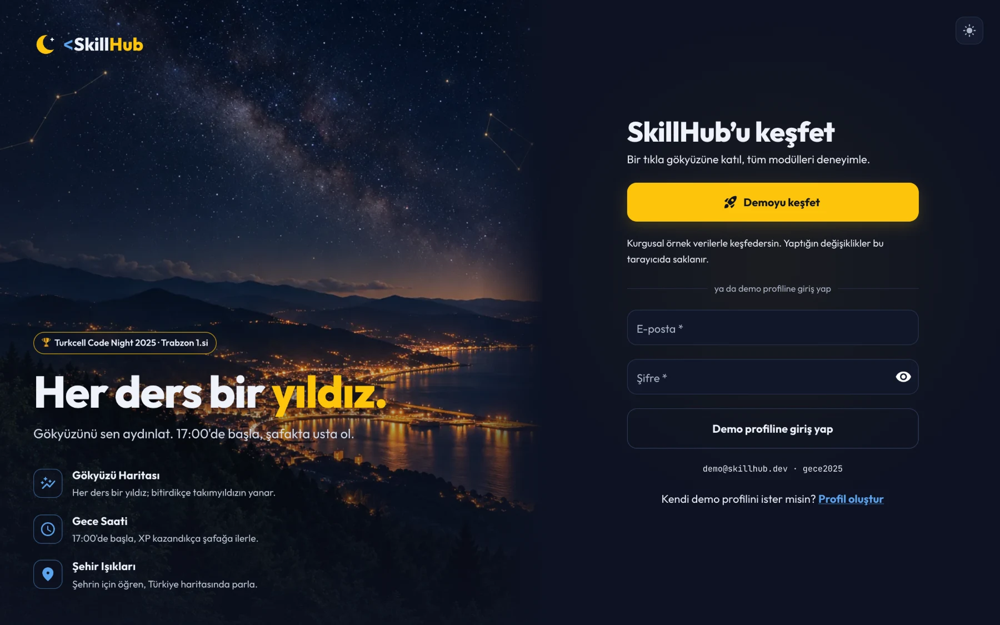
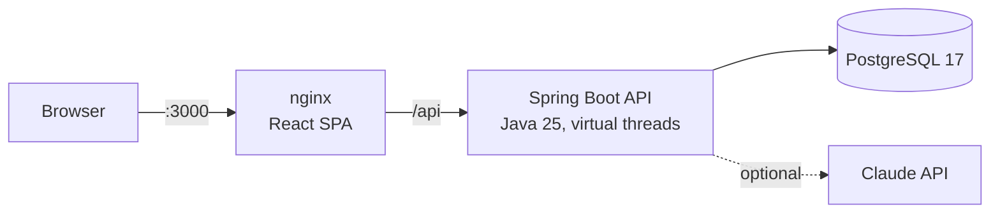

<div align="center">



# SkillHub

### Every lesson is a star. Light up your sky.

A night-themed, gamified digital-skills platform for young people.<br>
**🏆 1st place · Turkcell Code Night 2025 · Trabzon**

[**Live demo**](https://skillhub-turkcell.vercel.app) ·
[Run it in one command](#run-it-in-one-command) ·
[Türkçe](README.md)

</div>

---

My teammate Ayşe Mandıralı and I built SkillHub during the Trabzon night of Turkcell Code Night 2025 and took
first place; I was the captain of our two-person team. This repository is the **second version, rewritten from scratch**: a real database, clean
architecture on both sides, and a decision I can explain behind every screen.

Every lesson is a star and every topic is a constellation. Pass a quiz and your star lights up. The XP you earn
moves your **Night Clock** from 17:00 toward dawn, just like the 14-hour hackathon where the project was born.

> **Try it in one minute:** open the [live demo](https://skillhub-turkcell.vercel.app) and press
> **Demoyu keşfet**. The hosted demo runs entirely in the browser, so it stays online at zero cost, and it
> speaks the same API contract as the backend. The full stack (Spring Boot + PostgreSQL + nginx) starts
> locally with `docker compose up --build`.

## From hackathon to v2

A hackathon project wins on its idea and its demo; it is not production code. I reviewed the original build
like a code review, kept its [screenshots](eski/) as a memento and rebuilt the system:

| | Hackathon night | v2 (this repository) |
|---|---|---|
| **Sign-in** | Users in `localStorage`, demo passwords on screen | Stateless JWT, BCrypt, timing-safe login |
| **Leaderboard** | Backend returned `null` names, the frontend invented them | Ranked in SQL with window functions from an append-only XP ledger |
| **XP** | Every submission paid again | XP only for beating your previous best |
| **AI** | API key committed and revoked as leaked | Key from the environment, validated output, rule-based fallback |
| **Setup** | Manual, machine by machine | `docker compose up --build` |

## Engineering highlights

1. **XP is a ledger, not a counter.** `xp_events` is append-only; totals, levels and rankings are derived on
   read with `RANK() OVER (...)`, so no copied score can drift out of sync.
2. **Anti-farming by design.** Retaking a quiz pays only the difference over your previous best.
3. **One attempt, one transaction.** Grading, the attempt, XP and badges commit together. The learner row is
   locked `FOR UPDATE`, so a double-click cannot pay the same improvement twice.
4. **Correct answers never reach the client.** A pure domain function validates and grades the answer sheet.
5. **The database guards the rules too.** A partial unique index allows one correct option per question; a
   sign-up race on the same email ends in a clean `409`, not a `500`.
6. **Open/Closed badges.** Each badge is a `BadgeRule` strategy; adding one never touches the evaluator.
7. **AI that cannot make things up.** Claude sees only the learner's real progress, every suggestion is
   checked against lessons the learner can open, and a deterministic rule engine answers on any failure.
8. **Demo data through the real rules.** 30 fictional learners replay four weeks of history through the real
   `QuizService`.
9. **Secure defaults.** Identity comes only from the token (`@CurrentUser`), login does not leak which emails
   exist, and every error is an RFC 9457 Problem Details response.
10. **One frontend, two deployments.** The same UI runs as a zero-cost browser demo on Vercel and against the
    real API in Docker; API builds drop the demo code entirely.
11. **Small, readable files.** Clean Architecture on both sides; no hand-written file exceeds 300 lines.

## Architecture



A modular monolith: `identity`, `geo`, `catalog`, `quiz`, `progress`, `leaderboard`, `guide` and `demo`, each
split into `domain` → `application` → `infrastructure` → `web`. The domain is plain Java; the database, JWT and
Claude live only in infrastructure adapters.

| Layer | Choices |
|---|---|
| Backend | Java 25, Spring Boot 4.1, Spring Security (JWT resource server), `JdbcClient` with explicit SQL, Flyway |
| Data | PostgreSQL 17 |
| AI | Official Anthropic Java SDK with structured outputs, rule-based fallback |
| Frontend | React 19, TypeScript (strict), Vite 8, Material UI 9, TanStack Query 5, React Router 8 |
| Delivery | Docker Compose with health-checked startup, nginx, Vercel |

## Run it in one command

All you need is Docker.

```bash
git clone https://github.com/mrfiratatalay/Turkcell-Skillhub.git
cd Turkcell-Skillhub
docker compose up --build
```

Open http://localhost:3000 (Swagger UI: http://localhost:3000/api/docs). An empty database is seeded with 30
fictional learners; sign in with **Demo hesabıyla keşfet** or `demo@skillhub.dev` / `gece2025`.

## Documentation

The detailed write-ups live in [`docs/`](docs/README.md) and are written in Turkish: the story, architecture,
database, game rules, security, the AI guide, frontend and design, deployment strategy, the problems I solved,
and an honest list of limitations with a roadmap.

## Team

Built by a two-person team: **Fırat Atalay**, team captain ([GitHub](https://github.com/mrfiratatalay)), and
**Ayşe Mandıralı**.

SkillHub was born at Turkcell Academy's *Geleceği Yazanlar* Code Night 2025 in Trabzon. This is an independent
portfolio project, not an official Turkcell product; Turkcell and Code Night are trademarks of their
respective owners and are mentioned only to credit the event.
