<div align="center">

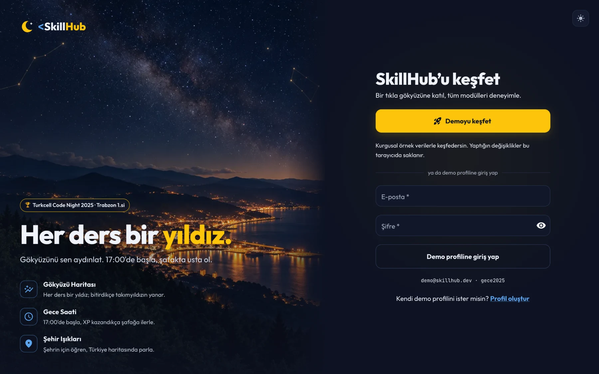

# SkillHub

### Her ders bir yıldız. Gökyüzünü sen aydınlat.

Gençlere dijital beceri kazandıran, gece temalı ve oyunlaştırılmış bir öğrenme platformu.<br>
**🏆 Turkcell Code Night 2025 · Trabzon birincisi**

[**Canlı demo**](https://skillhub-turkcell.vercel.app) ·
[Dokümanlar](docs/README.md) ·
[Tek komutla çalıştır](#tek-komutla-çalıştır) ·
[English](README.en.md)


</div>

---

SkillHub'ı Turkcell Code Night 2025'in Trabzon gecesinde takım arkadaşım Ayşe Mandıralı ile geliştirdik ve
birinci olduk; iki kişilik takımımızın kaptanıydım. Bu repo, o gece yazdığımız hackathon projesinin **sıfırdan yeniden yazılmış ikinci sürümü**:
gerçek bir veritabanı, iki tarafta da temiz bir mimari ve her ekranın arkasında anlatılabilir bir karar.

Her ders gökyüzünde bir yıldız, her konu bir takımyıldız. Bir dersin quiz'ini geçtiğinde yıldızın yanar.
Kazandığın XP ile **Gece Saati** 17:00'den şafağa ilerler, tıpkı projenin doğduğu 14 saatlik gece gibi.
Şehrin de Türkiye'nin gece haritasında, öğrencileri öğrendikçe daha parlak yanar.

## Nasıl incelersin?

| Ne kadar vaktin var? | Önerim |
|---|---|
| 1 dakika | [Canlı demoyu](https://skillhub-turkcell.vercel.app) aç ve **Demoyu keşfet**'e bas. Kurulum ya da hesap gerekmez. |
| 5 dakika | [Demo turu](docs/02-demo-turu.md) ile her modülü sırayla gez. |
| 15 dakika | [Mimari](docs/03-mimari.md) ve [Çözdüğüm problemler](docs/11-cozdugum-problemler.md) ile kodun arkasındaki kararları oku. |
| Gerçek sistemi görmek istiyorsan | [Tek komutla](#tek-komutla-çalıştır) PostgreSQL, API ve arayüzü kendi makinende çalıştır. |

Canlı demo, sunucu masrafı olmadan her zaman açık kalabilsin diye tarayıcıda çalışıyor ve backend ile birebir
aynı API sözleşmesini kullanıyor. Nedenini [Yayın stratejisi](docs/09-yayin-stratejisi.md)'nde anlattım.

## Hikâye: bir gece, sonra baştan

**20 Kasım 2025, 17:00.** Turkcell Academy *Geleceği Yazanlar* Code Night'ın Trabzon durağı başladı: beş vaka
ve sabah 07:00'ye kadar on dört saat. SkillHub vakasını seçtik; ilk commit 20:13'te, son commit 06:27'de
atıldı ve sabah **birinci olduk**.

Bir hackathon projesi fikriyle ve demosuyla kazanır; üretim kodu değildir. O geceki sürümü bir kod incelemesi
gibi baştan sona inceledim, ekran görüntülerini [`eski/`](eski/) klasöründe hatıra olarak sakladım ve sistemi
**sıfırdan yeniden yazdım**. Hikâyenin tamamı: [docs/01-hikaye.md](docs/01-hikaye.md).

| | Hackathon gecesi | v2 (bu repo) |
|---|---|---|
| **Giriş** | Kullanıcılar `localStorage`'da, demo şifreler ekranda | Stateless JWT, BCrypt, cevap süresinden e-posta sızdırmayan giriş |
| **Sıralama** | Backend `null` isim döndürüyor, frontend uyduruyordu | XP defterinden SQL window fonksiyonlarıyla hesaplanıyor |
| **XP** | Her gönderim yeniden puan veriyordu | Yalnızca en iyi skorunu geçtiğin kadar XP |
| **Yapay zekâ** | Anahtar repodaydı, Google kapattı | Anahtar ortam değişkeninde, çıktı doğrulanıyor, kural tabanlı yedek var |
| **Mobil** | Ders sayfaları 390 px ekrandan taşıyordu | Alt gezinme çubuğu, önce telefona göre tasarlanmış ekranlar |
| **Teknoloji** | Spring Boot 3.5 · Java 21 · React 18 · MUI 7 | Spring Boot 4.1 · Java 25 · React 19 · MUI 9 |
| **Kurulum** | Elle, makine makine | `docker compose up --build` |

## Neler yapabilirsin?

<table>
  <tr>
    <td width="50%">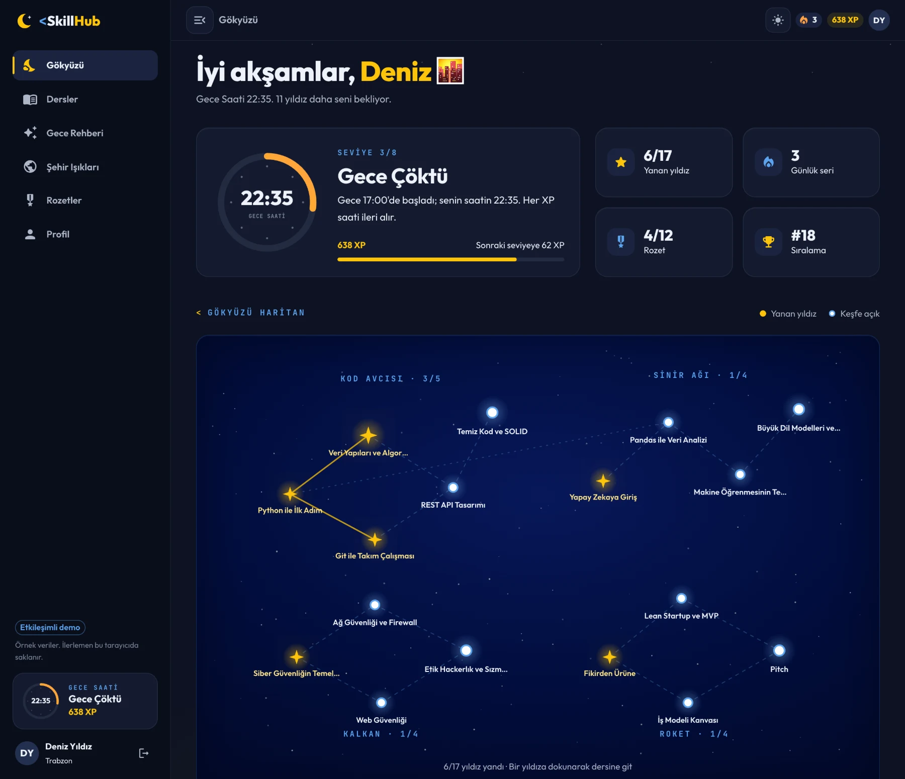</td>
    <td width="50%">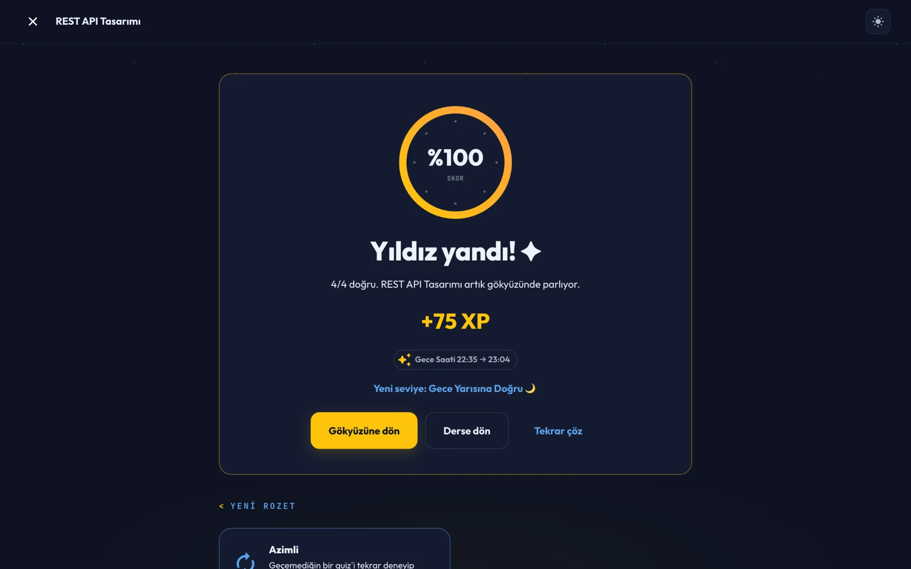</td>
  </tr>
  <tr>
    <td><b>Gökyüzü.</b> 4 takımyıldız, 17 ders. Ön koşul çizgileri hangi yıldızın sırada olduğunu gösterir;
    yıldızlar kilitli, keşfe açık ya da yanmış olabilir.</td>
    <td><b>Sunucuda puanlanan quiz.</b> Tek cevap; skoru, XP'yi, Gece Saati'nin ilerleyişini, yeni rozetleri,
    açılan dersleri ve her sorunun açıklamasını getirir.</td>
  </tr>
  <tr>
    <td>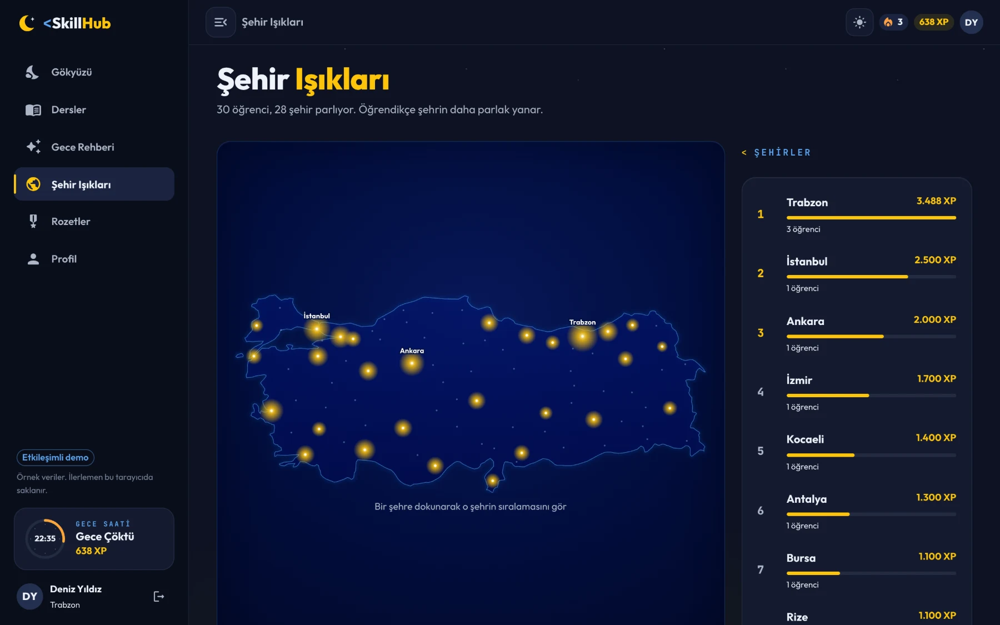</td>
    <td>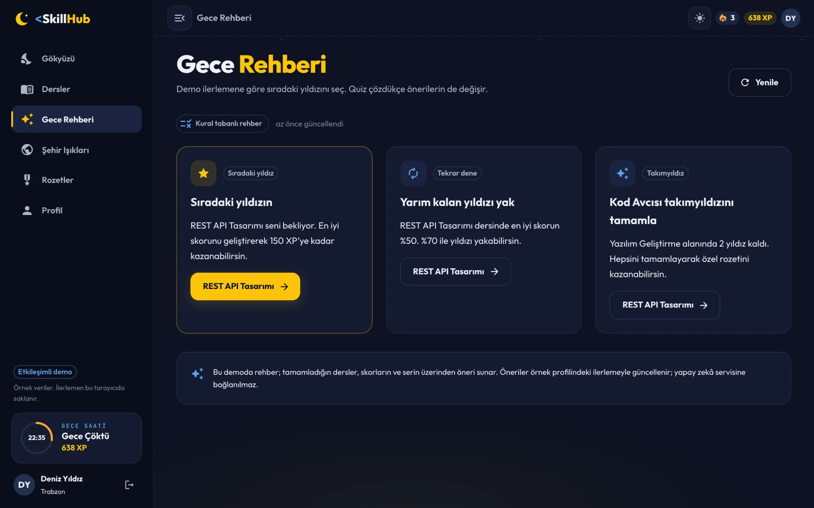</td>
  </tr>
  <tr>
    <td><b>Şehir Işıkları.</b> 81 ilin gece haritası. Şehirler öğrencilerinin XP'siyle parlar; bir şehre
    dokununca o şehrin sıralaması açılır.</td>
    <td><b>Gece Rehberi.</b> Gerçek ilerlemeden üretilen üç kişisel öneri. Claude yazar, sunucu doğrular;
    anahtar yoksa kural tabanlı rehber cevap verir.</td>
  </tr>
  <tr>
    <td>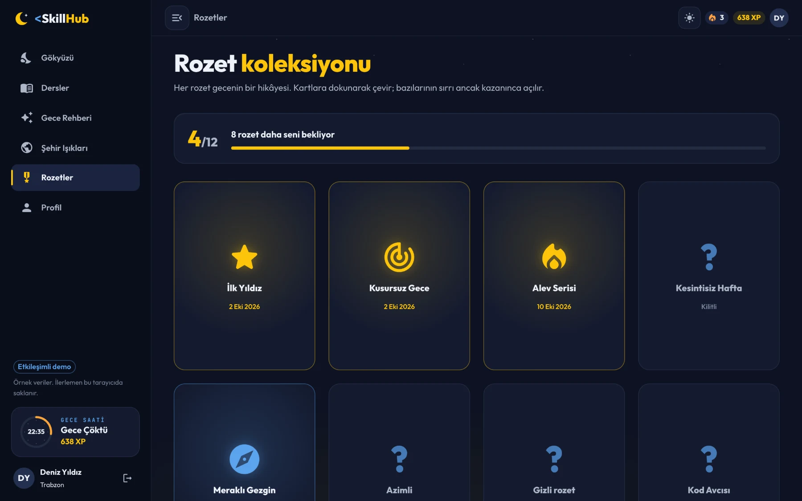</td>
    <td>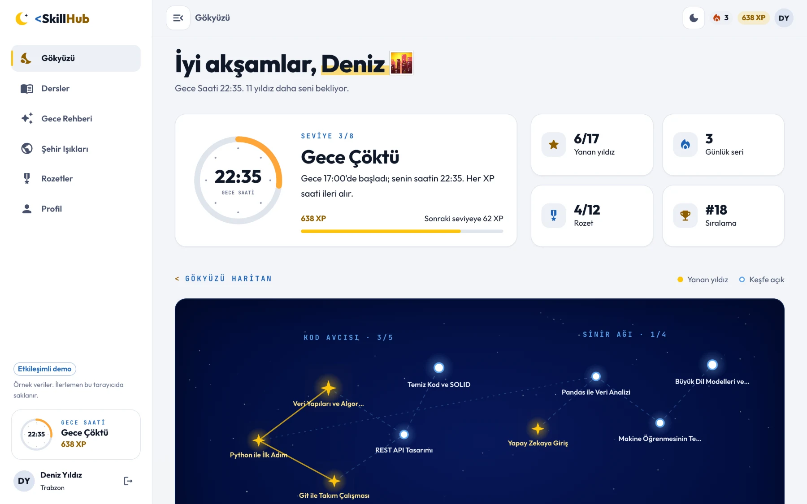</td>
  </tr>
  <tr>
    <td><b>Rozetler.</b> 12 koleksiyon kartı, ikisi gizli. <i>Gece Kuşu</i>, gece yarısından sonra quiz
    çözene kadar sırrını saklar: "Gerçek kodcu gece çalışır."</td>
    <td><b>İki renk şeması.</b> Varsayılan koyu <i>Gece</i> ve açık <i>Şafak</i>; geçiş, sayfa yeniden
    çizilmeden CSS değişkenleriyle olur.</td>
  </tr>
</table>

<p align="center">
  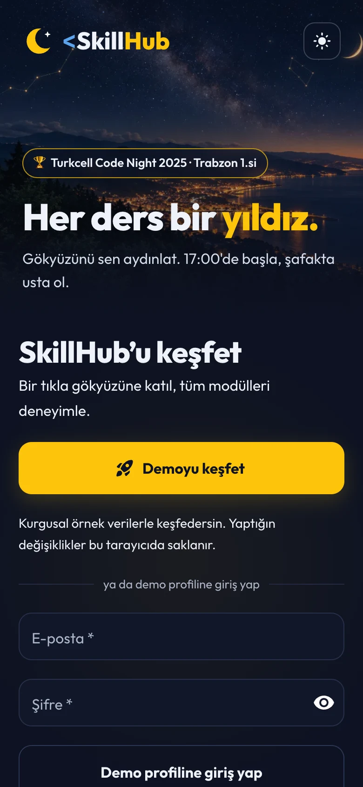&nbsp;
  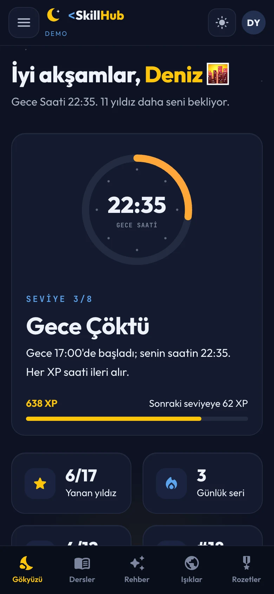&nbsp;
  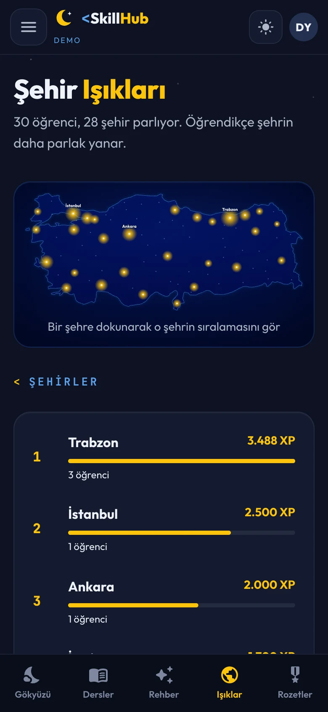
</p>

**Gece Saati** seviye sistemidir: 8 seviye, her biri gecenin iki saati. *Alacakaranlık* (17:00) ile başlar,
*Şafak* (07:00) ile biter. Şafağa ulaşmak gizli bir rozet açar.

## Mühendislik tarafında öne çıkanlar

Mülakatlarda en sevdiğim konular; her biri bu repodaki koda dayanıyor:

1. **XP bir defter, sayaç değil.** `xp_events` yalnızca eklenir. Toplam, seviye ve sıralamalar her okumada
   buradan türetilir; kopyalanıp senkron dışı kalabilecek bir puan yok. → [Veritabanı](docs/04-veritabani.md)
2. **XP kasılamaz.** Bir quiz'i tekrar çözmek yalnızca önceki en iyi skorunu geçtiğin kadar XP kazandırır.
   → [Oyun kuralları](docs/05-oyun-kurallari.md)
3. **Bir deneme, tek transaction.** Puanlama, deneme kaydı, XP ve rozetler birlikte yazılır. Öğrenci satırı
   `FOR UPDATE` ile kilitlenir; çift tıklama aynı gelişmeyi iki kez ödetemez.
   → [Çözdüğüm problemler](docs/11-cozdugum-problemler.md)
4. **Doğru cevaplar istemciye hiç gitmez.** Cevap kâğıdı sunucuda, saf bir domain fonksiyonunda doğrulanıp
   puanlanır.
5. **Ön koşullar bir DAG.** Kilit kuralı saf bir politika; kilitli bir dersin açılış yolu özyinelemeli CTE ile
   tek sorguda gelir.
6. **Kurallar veritabanında da korunur.** Kısmi unique index ile her sorunun tek doğru şıkkı, `CHECK`
   kısıtları ve büyük/küçük harf duyarsız e-posta index'i; aynı e-postayla eşzamanlı kayıt `500` değil `409`
   ile biter.
7. **Rozetler Strategy deseniyle.** Her rozet bir `BadgeRule`; yeni rozet eklemek değerlendiriciye dokunmadan
   yeni bir sınıf yazmak demek.
8. **Uyduramayan yapay zekâ.** Claude yalnızca öğrencinin gerçek ilerlemesini görür, her önerisi açılabilir
   derslerle karşılaştırılır; ret, hata ya da anahtar yokluğunda kural motoru devreye girer.
   → [Gece Rehberi](docs/07-gece-rehberi.md)
9. **Gerçek kurallarla üretilen demo verisi.** 30 kurgusal öğrencinin dört haftalık geçmişi gerçek
   `QuizService` üzerinden oynatılır; tek bir satır elle eklenmez.
10. **Güvenli varsayılanlar.** Kimlik yalnızca token'dan (`@CurrentUser`), IDOR tasarım gereği imkânsız;
    zamanlamaya dayanıklı giriş; her hata RFC 9457 Problem Details. → [Güvenlik](docs/06-guvenlik.md)
11. **Tek arayüz, iki dağıtım.** Aynı kod Vercel'de backend'siz demo, Docker'da gerçek API ile çalışır; API
    derlemesinde demo kodu pakete hiç girmez. → [Yayın stratejisi](docs/09-yayin-stratejisi.md)
12. **Küçük, okunur dosyalar.** İki tarafta da Clean Architecture; elle yazılan hiçbir dosya 300 satırı geçmez.
    → [Mimari](docs/03-mimari.md)

## Mimari

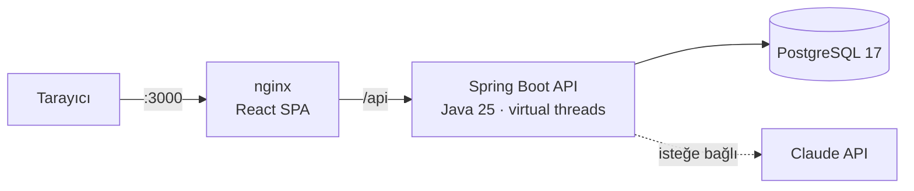

Backend bir **modüler monolit**: `identity`, `geo`, `catalog`, `quiz`, `progress`, `leaderboard`, `guide` ve
`demo` modüllerinin her biri `domain` → `application` → `infrastructure` → `web` katmanlarına ayrılıyor.
`domain` saf Java; veritabanı, JWT ve Claude yalnızca `infrastructure` içindeki adaptörlerde yaşıyor. Arayüz de
aynı ayrımı izliyor: her ekran `features/<ekran>/` altında kendi API kancalarıyla duruyor.
Ayrıntı: [docs/03-mimari.md](docs/03-mimari.md).

## Teknolojiler

| Katman | Seçimler |
|---|---|
| Backend | Java 25, Spring Boot 4.1 (Web MVC, Security, JDBC, Validation, Actuator), virtual threads |
| Kimlik | Stateless JWT (HS256, OAuth2 Resource Server), BCrypt |
| Veri | PostgreSQL 17, Flyway, `JdbcClient` ile açık SQL (ORM yok) |
| Yapay zekâ | Resmî Anthropic Java SDK, yapılandırılmış çıktı, kural tabanlı yedek motor |
| API dokümanı | springdoc-openapi (Swagger UI), RFC 9457 Problem Details |
| Frontend | React 19, TypeScript (strict), Vite 8, Material UI 9, MUI X Charts, Motion |
| Veri ve yönlendirme | TanStack Query 5, React Router 8 |
| Çalıştırma | Docker Compose (çok aşamalı derleme, root olmayan kullanıcı, sağlık kontrollü başlangıç), nginx, Vercel |

## Tek komutla çalıştır

Gereken tek şey Docker.

```bash
git clone https://github.com/mrfiratatalay/Turkcell-Skillhub.git
cd Turkcell-Skillhub
docker compose up --build
```

| Adres | Ne var |
|---|---|
| http://localhost:3000 | SkillHub |
| http://localhost:3000/api/docs | Swagger UI (giriş yapıp token'ı **Authorize**'a yapıştır) |

Boş veritabanına ilk açılışta 30 kurgusal öğrenci eklenir. **Demo hesabıyla keşfet** düğmesiyle ya da
`demo@skillhub.dev` / `gece2025` ile girebilirsin. Her ayarın güvenli bir yerel varsayılanı var; değiştirmek
için [`.env.example`](.env.example) dosyasını `.env` olarak kopyala. Geliştirme modları, ortam değişkenleri ve
örnek isteklerle API: [docs/10-calistirma-ve-api.md](docs/10-calistirma-ve-api.md).

## Dokümanlar

Projeyi kendi anlatımımla, ayrıntısıyla [`docs/`](docs/README.md) klasöründe açıkladım:

| | |
|---|---|
| [01 · Hikâye](docs/01-hikaye.md) | Code Night gecesi, hackathon kodunun incelemesi, neden baştan yazdım |
| [02 · Demo turu](docs/02-demo-turu.md) | Teknik bilgi gerektirmeyen 5 dakikalık tur |
| [03 · Mimari](docs/03-mimari.md) | Modüler monolit, katmanlar, bir isteğin yolculuğu |
| [04 · Veritabanı](docs/04-veritabani.md) | XP defteri, ön koşul grafiği, veritabanında korunan kurallar |
| [05 · Oyun kuralları](docs/05-oyun-kurallari.md) | Puanlama, XP politikası, Gece Saati, seriler, rozetler |
| [06 · Güvenlik](docs/06-guvenlik.md) | JWT, BCrypt, zamanlama saldırısı, IDOR, bilinen eksikler |
| [07 · Gece Rehberi](docs/07-gece-rehberi.md) | Claude'u doğrulama ve yedek motorla güvenle kullanmak |
| [08 · Arayüz ve tasarım](docs/08-arayuz-ve-tasarim.md) | Frontend mimarisi ve Sakin Gece tasarım dili |
| [09 · Yayın stratejisi](docs/09-yayin-stratejisi.md) | Sunucu masrafı olmadan her zaman açık canlı demo |
| [10 · Çalıştırma ve API](docs/10-calistirma-ve-api.md) | Kurulum, ayarlar, örnek isteklerle API |
| [11 · Çözdüğüm problemler](docs/11-cozdugum-problemler.md) | Problem, çözüm, gerekçe: on iki kısa hikâye |
| [12 · Sorular ve sınırlar](docs/12-sorular-ve-sinirlar.md) | Sık sorulan teknik sorular, bilinen sınırlar, yol haritası |

## Proje yapısı

```text
backend/            Spring Boot API: modül başına domain / application / infrastructure / web
frontend/           React + MUI arayüzü, nginx yapılandırması ve backend'siz demo adaptörü
docs/               Ayrıntılı dokümanlar ve ekran görüntüleri
eski/               Hackathon gecesindeki sürümün ekran görüntüleri, hatıra olarak
docker-compose.yml  Bütün sistem tek komutla
```

## Ekip

SkillHub'ı Code Night gecesi iki kişilik bir takım olarak geliştirdik ve birlikte kazandık:

- **Fırat Atalay** · takım kaptanı · [GitHub](https://github.com/mrfiratatalay)
- **Ayşe Mandıralı** · takım arkadaşı

O gece için Turkcell Academy *Geleceği Yazanlar* ve Code Night ekibine teşekkür ederiz. Arayüz renklerini ve
ruhunu o geceden alıyor: Code Night sarısı, gece mavisi gökyüzü ve hilal. Bu bağımsız bir portfolyo projesidir,
resmî bir Turkcell ürünü değildir; Turkcell ve Code Night adları sahiplerine aittir ve yalnızca etkinliğe atıf
için anılmıştır.
