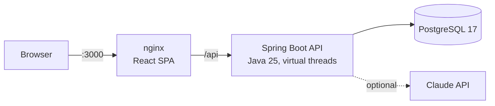

<div align="center">


# SkillHub

### Every lesson is a star. Light up your sky.

A gamified digital-skills platform for young people.<br>
**🏆 1st place · Turkcell Code Night 2025 · Trabzon**

[**Live demo**](https://skillhub-turkcell.vercel.app) ·
[Run it in one command](#run-it-in-one-command) ·
[Engineering highlights](#engineering-highlights) ·
[Türkçe](README.tr.md)


</div>

---

SkillHub teaches young people software, AI, cybersecurity and entrepreneurship through a night sky.
Every lesson is a star and every category is a constellation. Pass a quiz and your star lights up.
Earn XP and your **Night Clock** moves from 17:00 toward dawn, just like the real 14-hour hackathon
where the project was born. Your city shines brighter on a night map of Türkiye with every lesson you finish.

> **Try it in 10 seconds:** open the [live demo](https://skillhub-turkcell.vercel.app) and press
> **Demoyu keşfet**. The hosted demo runs fully in the browser and uses the same API contract as the backend.
> The full stack (Spring Boot + PostgreSQL + nginx) starts locally with `docker compose up --build`.

## The story: one night, then a rewrite

On **20 November 2025, 17:00**, Turkcell Academy's *Geleceği Yazanlar* **Code Night** opened its Trabzon stop:
teams of three, five cases, fourteen hours until **07:00**. Our team took the SkillHub case, a platform where
young people watch lessons, take quizzes, earn badges and follow their progress. The first commit landed at
20:13, the last one at 06:27, and in the morning **we took first place**.

A hackathon build wins on its idea and its demo. It is not production code, and we knew it. So I reviewed it
honestly, kept the [screenshots of that night](eski/) as a memento, and **rebuilt the whole system from
scratch**: database, backend and interface, with a real architecture behind every screen.

| | Hackathon night | v2 (this repository) |
|---|---|---|
| **Sign-in** | Users stored in `localStorage`, demo passwords printed on the login screen | Stateless JWT (HS256), BCrypt, timing-safe login |
| **Leaderboard** | Backend returned `null` names, the frontend invented random ones | Ranked in SQL with window functions from an append-only XP ledger |
| **XP** | Every submission paid again, so one quiz could be farmed forever | XP is paid only for improving your best score |
| **AI assistant** | Gemini key committed to the repo and auto-revoked as leaked | Claude via the official SDK, key from the environment, validated output, rule-based fallback |
| **Mobile** | Lesson pages overflowed a 390 px screen | Bottom navigation and fluid layouts designed for 390 px first |
| **Stack** | Spring Boot 3.5 · Java 21 · React 18 · MUI 7 | Spring Boot 4.1 · Java 25 · React 19 · MUI 9 |
| **Setup** | Manual, machine by machine | One command: `docker compose up --build` |

## What you can do

<table>
  <tr>
    <td width="50%"></td>
    <td width="50%"></td>
  </tr>
  <tr>
    <td><b>Sky map (Gökyüzü).</b> 4 constellations, 17 lessons. Prerequisite lines show which star opens next;
    stars are locked, open to explore, or lit.</td>
    <td><b>Server-graded quizzes.</b> One answer returns your score, XP, Night Clock jump, new badges and the
    lessons you just unlocked, plus an explanation for every question.</td>
  </tr>
  <tr>
    <td></td>
    <td></td>
  </tr>
  <tr>
    <td><b>City Lights (Şehir Işıkları).</b> All 81 provinces on a night map of Türkiye. A city glows with the
    XP of its learners; tap it for the ranking inside that city.</td>
    <td><b>Night Guide (Gece Rehberi).</b> Three personal next steps written by Claude from your real progress.
    No API key? A deterministic rule engine answers instead.</td>
  </tr>
  <tr>
    <td></td>
    <td></td>
  </tr>
  <tr>
    <td><b>Badges.</b> 12 collectible cards, two of them secret. <i>Gece Kuşu</i> stays a mystery until you
    finish a quiz after midnight: "a real coder works at night".</td>
    <td><b>Two color schemes.</b> The calm dark <i>Gece</i> (default) and the light <i>Şafak</i>, switched
    without a flash through MUI's CSS-variable color schemes.</td>
  </tr>
</table>

<p align="center">
  &nbsp;
  &nbsp;
  
</p>

**The Night Clock (Gece Saati)** is the level system: 8 levels, each one a two-hour slice of the night from
*Alacakaranlık* (17:00) to *Şafak* (07:00). XP moves the hands; reaching dawn unlocks a secret badge.

## Engineering highlights

The parts I enjoy discussing in an interview, each one backed by code in this repository:

1. **XP is a ledger, not a counter.** `xp_events` is append-only. Totals, levels and rankings are derived on
   read with `RANK() OVER (PARTITION BY city_id ...)`, so there is no copied score that can drift out of sync.
2. **Anti-farming by design.** `XpPolicy` pays only the difference over your previous best, which closes the
   exploit the hackathon version had.
3. **One attempt, one transaction.** Grading, storing the attempt, XP and badges commit together. The learner
   row is locked `FOR UPDATE`, so a double-click cannot pay the same improvement twice.
4. **The client never sees correct answers.** `QuizGrader` is a pure domain function that validates the answer
   sheet and scores it on the server.
5. **Prerequisites form a DAG.** Lesson unlocks are evaluated by a pure policy; the unlock path of a locked
   lesson comes from a recursive CTE.
6. **The database guards the rules too.** A partial unique index allows at most one correct option per
   question; `CHECK` constraints and a case-insensitive email index back up the application, and a sign-up
   race on the same address ends in a clean `409`, not a `500`.
7. **Open/Closed badges.** Each badge is a `BadgeRule` strategy. Adding a badge means adding a class, never
   editing the evaluator.
8. **AI that cannot hallucinate into the UI.** Claude (official Anthropic Java SDK, structured outputs) only
   sees the learner's real progress, and every suggested lesson is checked against lessons the learner can
   actually open. On a refusal, error or missing key, the rule engine answers. Results are cached for 10
   minutes, invalidated by a domain event after each committed attempt, and refreshes are rate-limited.
9. **Demo data through the real rules.** 30 fictional learners replay 28 days of history through the real
   `QuizService`, so their XP, streaks and badges come from the same code as live traffic. Nothing is
   inserted by hand.
10. **Secure defaults.** Identity comes only from the token (`@CurrentUser`), never from the request body, so
    IDOR is impossible by construction. Login compares against a decoy hash when the email is unknown, so
    response times do not reveal registered addresses. Every error is an RFC 9457 Problem Details response,
    with field errors the form shows under the right input.
11. **One switch for two deployments.** The frontend picks its transport in one place: `api` talks to Spring
    Boot, `demo` answers the same contract in the browser. That is how a full-stack project also lives on
    Vercel as a zero-backend portfolio.
12. **Small, readable files.** SOLID on both sides, and no file in the repository exceeds 300 lines
    (the largest source file has 249).

## Architecture



The backend is a modular monolith with **Clean Architecture** inside every module:
`domain` (pure rules and ports) → `application` (use cases, transactions) → `infrastructure`
(`JdbcClient` repositories, JWT, BCrypt, Claude adapters) → `web` (controllers and DTOs).

| Module | Responsibility |
|---|---|
| `identity` | Registration, login, profile |
| `catalog` | Constellations, lessons, prerequisite graph, the learner's sky |
| `quiz` | Quizzes, server-side grading, attempt history |
| `progress` | XP ledger, Night Clock, streaks, badges |
| `leaderboard` | Individual and city rankings |
| `guide` | Night Guide (Claude with rule-based fallback) |
| `geo` · `demo` | 81 provinces · realistic seed data for an empty database |

The frontend mirrors the split: every screen lives in `features/<name>/` with its own API hooks, every route is
its own lazy-loaded chunk, server state goes through TanStack Query, and shared pieces sit in `shared/`.

## Tech stack

| Layer | Choices |
|---|---|
| Backend | Java 25, Spring Boot 4.1 (Web MVC, Security, JDBC, Validation, Actuator), virtual threads |
| Auth | Stateless JWT (HS256) via OAuth2 Resource Server, BCrypt |
| Data | PostgreSQL 17, Flyway migrations, `JdbcClient` with explicit SQL (no ORM) |
| AI | Official Anthropic Java SDK, structured outputs, rule-based fallback engine |
| API docs | springdoc-openapi (Swagger UI), RFC 9457 Problem Details |
| Frontend | React 19, TypeScript, Vite 8, Material UI 9, MUI X Charts, Motion |
| Data & routing | TanStack Query 5, React Router 8 |
| Delivery | Docker Compose (multi-stage builds, non-root runtime, health-checked startup order), Vercel |

## Run it in one command

All you need is Docker.

```bash
git clone https://github.com/mrfiratatalay/Turkcell-Skillhub.git
cd Turkcell-Skillhub
docker compose up --build
```

| Address | What is there |
|---|---|
| http://localhost:3000 | SkillHub |
| http://localhost:3000/api/docs | Swagger UI (sign in, then paste the token into **Authorize**) |

An empty database is seeded with 30 fictional learners. Press **Demo hesabıyla keşfet** or sign in with
`demo@skillhub.dev` / `gece2025`. Every setting has a safe local default; copy [`.env.example`](.env.example)
to `.env` to change them, for example to add an `ANTHROPIC_API_KEY` for the Claude-powered guide.

<details>
<summary><b>Local development without rebuilding containers</b></summary>

```bash
# Database and API in Docker, frontend with Vite hot reload on http://localhost:5173
docker compose up db api
cd frontend && npm install && VITE_DATA_MODE=api npm run dev

# Backend from your IDE or the Maven wrapper, against the database in Docker
docker compose up db
cd backend && DB_URL=jdbc:postgresql://localhost:5433/skillhub ./mvnw spring-boot:run

# Browser-only portfolio demo, no backend needed
cd frontend && npm run dev
```

Deployment and demo-mode details: [`frontend/README.md`](frontend/README.md).
</details>

## API at a glance

Everything lives under `/api/v1`. All endpoints except register, login and the city list require
`Authorization: Bearer <token>`. The full contract is in Swagger UI.

| Endpoint | Purpose |
|---|---|
| `POST /auth/register` · `POST /auth/login` | Create an account or sign in, returns a token |
| `GET /me` · `PATCH /me` | Profile with Night Clock, XP, streak and rank · update profile |
| `GET /me/xp-history` · `GET /me/attempts` | Daily XP chart · recent attempts |
| `GET /sky` | The learner's sky: constellations, stars and prerequisite lines |
| `GET /lessons` · `GET /lessons/{slug}` | Filterable catalog · lesson detail with its unlock path |
| `GET /lessons/{slug}/quiz` · `POST /lessons/{slug}/attempts` | Get a quiz without answers · submit it |
| `GET /badges` | Badge collection (unearned secret badges stay hidden) |
| `GET /leaderboard` · `GET /leaderboard/cities` | Individual ranking · city lights for the map |
| `GET /guide` · `POST /guide/refresh` | Night Guide recommendations · regenerate (rate-limited) |
| `GET /cities` | The 81 provinces of Türkiye |

## Repository layout

```text
backend/            Spring Boot API: one package per module, each with domain / application / infrastructure / web
frontend/           React + MUI app, nginx config and the browser-only demo adapter
docs/screenshots/   Images used in this README
tasarim/            Design work: style tile and the "Sakin Gece" concept with before/after visuals
eski/               Screenshots of the original hackathon build, kept as a memento
docker-compose.yml  The whole system in one command
```

## Team & credits

Built by **Fırat Atalay** · [GitHub](https://github.com/mrfiratatalay)

SkillHub was born at Turkcell Academy's *Geleceği Yazanlar* Code Night 2025 in Trabzon. The interface takes its
colors and spirit from that night: the Code Night yellow, the night-blue sky and the crescent moon.
This is an independent portfolio project, not an official Turkcell product; Turkcell and Code Night are
trademarks of their respective owners and are mentioned only to credit the event.
