<div align="center">

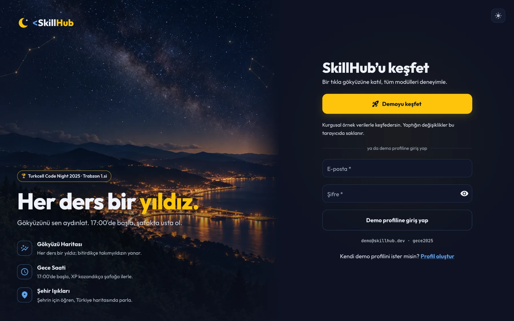

# SkillHub

### Her ders bir yıldız. Gökyüzünü sen aydınlat.

Gençlere dijital beceri kazandıran, oyunlaştırılmış bir öğrenme platformu.<br>
**🏆 Turkcell Code Night 2025 · Trabzon 1.si**

[**Canlı demo**](https://skillhub-turkcell.vercel.app) ·
[Tek komutla çalıştır](#tek-komutla-çalıştır) ·
[Tasarım kararları](#tasarım-kararları) ·
[English](README.md)


</div>

---

Her ders gökyüzünde bir yıldız, her kategori bir takımyıldız. Quiz'i geçtiğinde yıldızın yanar, XP kazandıkça
**Gece Saati** 17:00'den şafağa ilerler, şehrin Türkiye gece haritasında daha parlak parlar.

> **10 saniyede dene:** [Canlı demoyu](https://skillhub-turkcell.vercel.app) aç ve **Demoyu keşfet**'e bas.
> Yayındaki demo tamamen tarayıcıda çalışır ve backend ile aynı API sözleşmesini kullanır. Tam sistem
> (Spring Boot + PostgreSQL + nginx) yerelde `docker compose up --build` ile ayağa kalkar.

## Hikâye: bir gece, sonra baştan

**20 Kasım 2025, 17:00**'de Turkcell Academy *Geleceği Yazanlar* **Code Night**'ın Trabzon durağı başladı:
üç kişilik takımlar, beş farklı vaka ve sabah **07:00**'ye kadar on dört saat. Takımımız SkillHub vakasını seçti:
gençlerin ders izleyip quiz çözdüğü, rozet kazandığı ve gelişimini takip ettiği bir platform. İlk commit 20:13'te,
son commit 06:27'de atıldı ve sabah **birinci olduk**.

Bir hackathon projesi fikriyle ve demosuyla kazanır; üretim kodu değildir. Bu yüzden o geceki sürümü dürüstçe
inceledim, ekran görüntülerini [`eski/`](eski/) klasöründe hatıra olarak sakladım ve **sistemi baştan yazdım**:
veritabanı, backend ve arayüz, her ekranın arkasında gerçek bir mimariyle.

| | Hackathon gecesi | v2 (bu depo) |
|---|---|---|
| **Giriş** | Kullanıcılar `localStorage`'da, demo şifreler giriş ekranında yazılı | Stateless JWT (HS256), BCrypt, zamanlama saldırısına dayanıklı giriş |
| **Sıralama** | Backend isimleri `null` döndürüyor, frontend rastgele isim uyduruyordu | Yalnızca eklenen XP defterinden, SQL window fonksiyonlarıyla |
| **XP** | Her gönderim yeniden puan veriyordu, aynı quiz sonsuz kez kasılabiliyordu | XP yalnızca en iyi skorunu geçtiğin kadar verilir |
| **Yapay zekâ** | Gemini anahtarı repoya commit'lenmiş, Google sızdırılmış diye kapatmıştı | Resmî SDK ile Claude, anahtar ortam değişkeninde, doğrulanan çıktı, kural tabanlı yedek |
| **Mobil** | Ders sayfaları 390 px ekrandan taşıyordu | Alt gezinme çubuğu, önce 390 px için tasarlanmış akışkan yerleşim |
| **Teknoloji** | Spring Boot 3.5 · Java 21 · React 18 · MUI 7 | Spring Boot 4.1 · Java 25 · React 19 · MUI 9 |
| **Kurulum** | Elle, makine makine | Tek komut: `docker compose up --build` |

## Özellikler

- **Gökyüzü Haritası:** 4 takımyıldız, 17 ders. Ön koşul çizgileri derslerin hangi sırayla açıldığını gösterir.
- **Dersler ve quiz:** Ders notları, video, sunucuda puanlanan quiz ve her cevabın açıklaması. Doğru cevaplar
  istemciye hiç gönderilmez.
- **Gece Saati:** 8 seviyelik XP sistemi. Her seviye gecenin iki saati, son seviye şafak.
- **Rozetler:** 12 rozet, ikisi gizli ("Gerçek kodcu gece çalışır"). Kartlar dokununca dönen koleksiyon kartları.
- **Şehir Işıkları:** 81 ilin gece haritası, Türkiye ve şehir içi sıralamalar.
- **Gece Rehberi:** Claude ile kişisel öneriler. API anahtarı yoksa kural tabanlı motor devreye girer.
- **Profil:** 30 günlük XP grafiği, seriler, son denemeler ve profil düzenleme.
- **İki renk şeması:** Varsayılan koyu **Gece** ve açık **Şafak**. Seçim tarayıcıda saklanır.
- **Portfolyo demosu:** Frontend, backend olmadan tarayıcıda çalışan bir demo moduyla da yayınlanabilir.

<table>
  <tr>
    <td width="50%">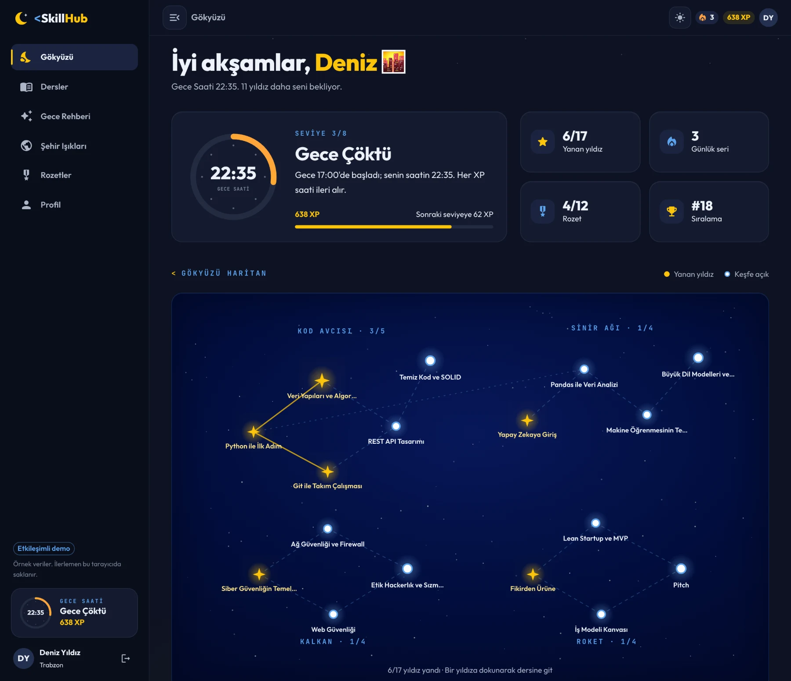</td>
    <td width="50%">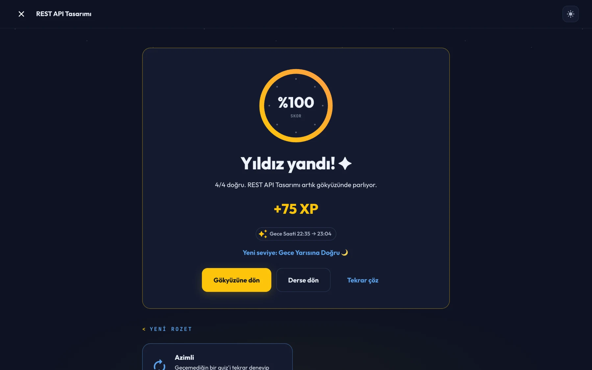</td>
  </tr>
  <tr>
    <td>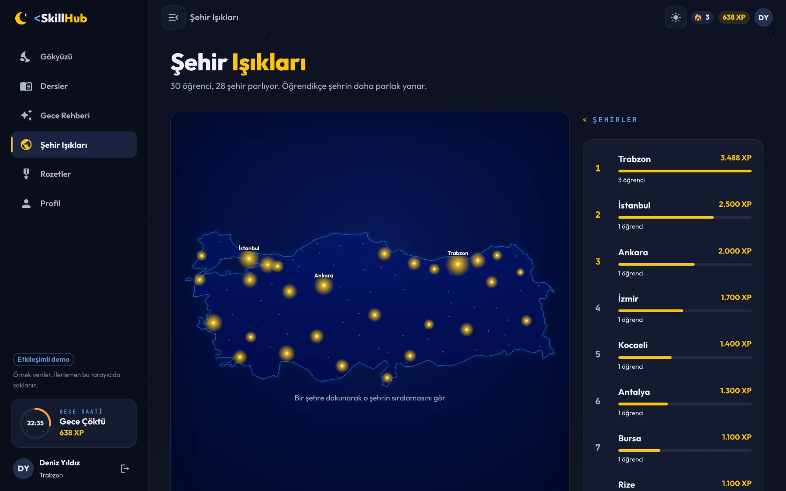</td>
    <td>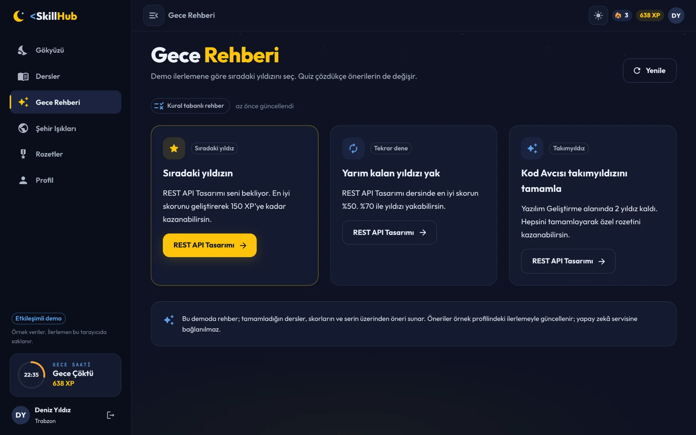</td>
  </tr>
  <tr>
    <td>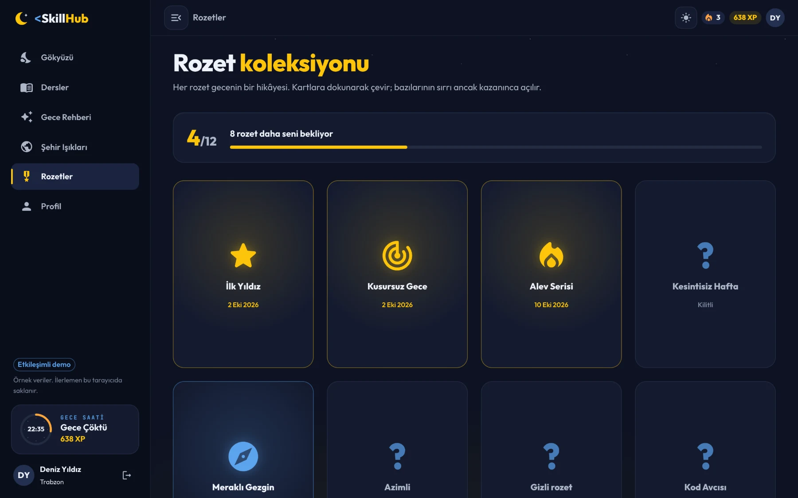</td>
    <td>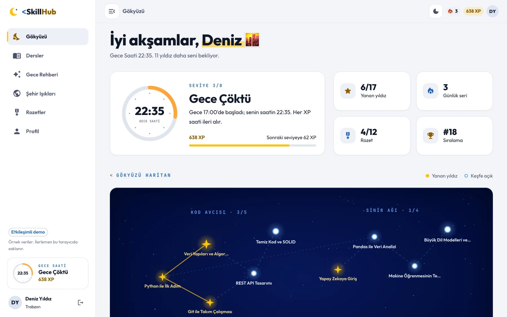</td>
  </tr>
</table>

<p align="center">
  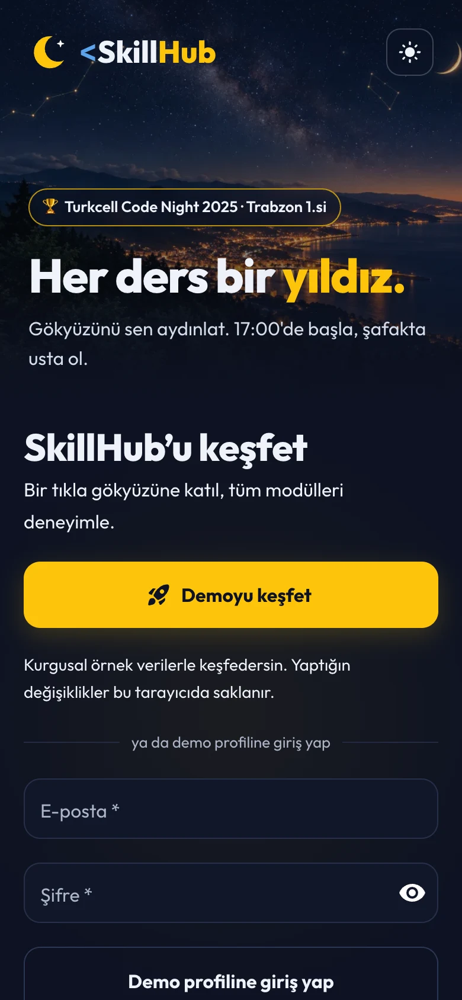&nbsp;
  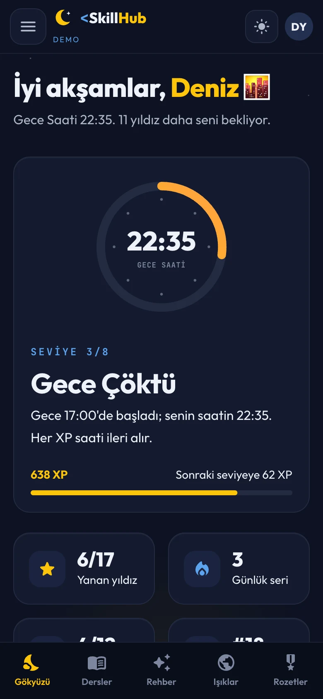&nbsp;
  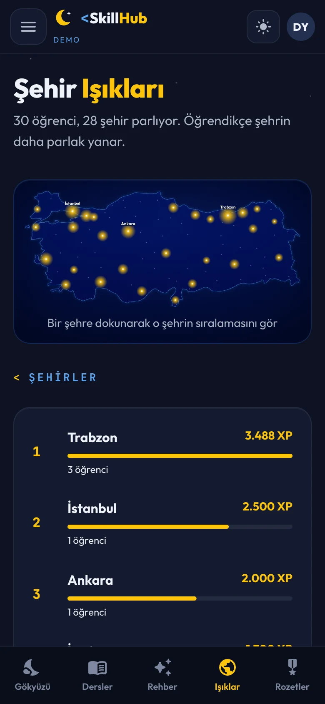
</p>

## Tek komutla çalıştır

Gereken tek şey Docker. Tek komut veritabanını, API'yi ve arayüzü kurup birbirine bağlar:

```bash
git clone https://github.com/mrfiratatalay/Turkcell-Skillhub.git
cd Turkcell-Skillhub
docker compose up --build
```

| Adres | Ne var |
|---|---|
| http://localhost:3000 | SkillHub |
| http://localhost:3000/api/docs | Swagger UI (önce giriş yapıp token'ı **Authorize**'a yapıştır) |

Boş bir veritabanına ilk açılışta 30 kurgusal öğrenci eklenir. Giriş ekranındaki **Demo hesabıyla keşfet**
düğmesi ya da `demo@skillhub.dev` / `gece2025` ile girebilirsin. Ayarları değiştirmek için
[`.env.example`](.env.example) dosyasını `.env` olarak kopyala. Her değerin güvenli bir yerel varsayılanı var.

## Teknolojiler

| Katman | Seçim |
|---|---|
| Backend | Java 25, Spring Boot 4.1 (Web MVC, Security, JDBC, Validation, Actuator), virtual threads |
| Kimlik | Stateless JWT (HS256, OAuth2 Resource Server), BCrypt |
| Veritabanı | PostgreSQL 17, Flyway, `JdbcClient` (ORM yok, SQL açık ve okunur) |
| Yapay zekâ | Resmî Anthropic Java SDK, yapılandırılmış çıktı, kural tabanlı yedek motor |
| API dokümanı | springdoc-openapi, RFC 9457 Problem Details hataları |
| Frontend | React 19, TypeScript, Vite 8, Material UI 9 (CSS değişkenli renk şemaları), MUI X Charts |
| Veri ve yönlendirme | TanStack Query 5, React Router 8, Motion |
| Çalıştırma | Docker Compose: PostgreSQL + API + nginx (aynı origin, tek açık port), Vercel |

## Mimari

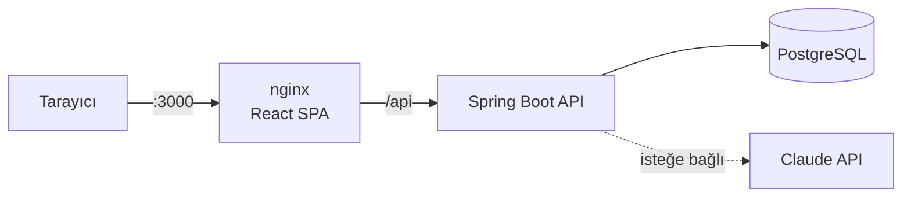

Backend, özellik bazlı modüllere ayrılmış bir **Clean Architecture** uygular. Her modülde aynı katmanlar var:

| Katman | Sorumluluk |
|---|---|
| `domain` | Saf iş kuralları ve portlar (ör. `XpPolicy`, `NightClock`, `LessonStatusPolicy`, rozet stratejileri) |
| `application` | Kullanım senaryoları, transaction sınırları, okuma modelleri |
| `infrastructure` | Port adaptörleri: `JdbcClient` depoları, JWT, BCrypt, Claude |
| `web` | Controller'lar ve istek / cevap kayıtları |

| Modül | İçerik |
|---|---|
| `identity` | Kayıt, giriş, profil |
| `geo` | 81 il, Türkçe alfabetik sıralama |
| `catalog` | Takımyıldızlar, dersler, ön koşul grafiği, gökyüzü |
| `quiz` | Quiz, sunucu tarafı puanlama, deneme geçmişi |
| `progress` | XP defteri, Gece Saati, seriler, rozetler |
| `leaderboard` | Kişi ve şehir sıralamaları |
| `guide` | Gece Rehberi (Claude + kural tabanlı yedek) |
| `demo` | Boş veritabanı için gerçekçi demo verisi |

Frontend aynı ayrımı izler: `features/*` her ekranı kendi API kancalarıyla taşır, `shared/` HTTP istemcisi,
oturum ve ortak arayüz parçalarını, `app/theme/` tasarım token'larını ve MUI temasını barındırır. Veri kaynağı
tek bir noktada seçilir. `api` modu gerçek backend'e gider; `demo` modu aynı sözleşmeyi tarayıcıda karşılar
(Vercel portfolyosu için).

## Veritabanı

Şema Flyway ile sürümlenir (`backend/src/main/resources/db/migration`): `V1` şemayı, `V2`–`V7` illeri,
kategorileri, rozetleri ve dört takımyıldızın derslerini ile sorularını yükler.

- **XP bir defterdir:** `xp_events` yalnızca eklenir. Toplamlar ve sıralamalar her okumada buradan türetilir;
  kopyalanmış, senkron dışı kalabilecek bir puan tablosu yoktur.
- **Ön koşullar bir DAG'dir:** `lesson_prerequisites` tablosu, kilitli bir dersin açılış yolunu özyinelemeli
  CTE ile çözer.
- **Kurallar veritabanında da korunur:** Bir sorunun birden fazla doğru şıkkı olamaması kısmi unique index ile,
  e-postaların büyük / küçük harf bağımsız tekilliği `lower(email)` index'i ile garanti altındadır.
- **Zaman:** Bütün zaman damgaları `TIMESTAMPTZ`. Seri gibi "yerel gün" hesapları Europe/Istanbul'a göre yapılır.

## API

Hepsi `/api/v1` altında. Kayıt, giriş ve şehir listesi dışındaki her uç `Authorization: Bearer <token>` ister.

| Uç | Açıklama |
|---|---|
| `POST /auth/register`, `POST /auth/login` | Hesap oluştur / giriş yap, token döner |
| `GET /cities` | 81 il |
| `GET /me`, `PATCH /me` | Profil, ilerleme özeti ve sıra / profil güncelleme |
| `GET /me/xp-history`, `GET /me/attempts` | XP grafiği ve son denemeler |
| `GET /sky` | Öğrencinin gökyüzü: takımyıldızlar, yıldızlar, çizgiler |
| `GET /lessons`, `GET /lessons/{slug}` | Ders kataloğu (filtreli) ve ders detayı |
| `GET /lessons/{slug}/quiz`, `POST /lessons/{slug}/attempts` | Quiz'i al, cevapları gönder |
| `GET /badges` | Rozet koleksiyonu |
| `GET /leaderboard`, `GET /leaderboard/cities` | Sıralama ve şehir ışıkları |
| `GET /guide`, `POST /guide/refresh` | Gece Rehberi önerileri (yenileme saatte 6 kez) |

## Tasarım kararları

- **XP yalnızca gelişme için verilir.** Bir quiz'i tekrar çözmek, önceki en iyi skorunun üzerine çıktığın kadar
  XP kazandırır. Hackathon sürümünde aynı quiz sonsuz kez puan veriyordu.
- **Bir deneme tek bir transaction'dır.** Puanlama, deneme kaydı, XP ve rozetler birlikte yazılır. Aynı
  öğrencinin eşzamanlı denemeleri sıraya girer, çift tıklama iki kez XP ödetemez.
- **Kimlik yalnızca token'dan gelir.** Kullanıcı kimliği hiçbir zaman istek gövdesinden okunmaz (`@CurrentUser`),
  başka birinin verisine erişme (IDOR) tasarım gereği mümkün değildir.
- **Giriş, hangi e-postaların kayıtlı olduğunu sızdırmaz.** Kullanıcı bulunmasa da sahte bir hash karşılaştırması
  yapılır, cevap süresi aynı kalır.
- **Yapay zekâ veri uyduramaz.** Claude yalnızca öğrencinin gerçek ilerlemesini görür. Önerdiği her ders
  sunucuda doğrulanır; hata, ret ya da anahtar yokluğunda kural tabanlı motor cevap verir.
- **Rozetler Açık/Kapalı ilkesine uyar.** Her rozet bir `BadgeRule` stratejisidir. Yeni rozet eklemek yeni bir
  sınıf eklemektir, değerlendiriciye dokunulmaz.
- **Demo verisi gerçek kurallarla üretilir.** Kurgusal öğrencilerin geçmişi gerçek `QuizService` üzerinden
  oynatılır; XP, rozet ve seriler canlı trafikle aynı kurallardan çıkar. Veri yalnızca boş veritabanına,
  tek transaction'da bir kez eklenir.
- **Hatalar tek biçimde döner.** Her hata RFC 9457 Problem Details'tir; alan hataları formda ilgili alanın
  altında gösterilir.
- **Sakin Gece arayüzü.** Code Night'ın doygun laciverti yalnızca gökyüzü "pencerelerinde" kullanılır, çalışma
  yüzeyleri göz yormayan mürekkep tonlarındadır. Parıltı bir ödüldür. Konsept ve gerekçeler
  [`tasarim/sakin-gece/`](tasarim/sakin-gece/) klasöründe.
- **Küçük, okunur dosyalar.** Depodaki hiçbir dosya 300 satırı geçmez.

## Yerel geliştirme

```bash
# Veritabanı ve API Docker'da; arayüz Vite ile canlı yenilemeli
docker compose up db api
cd frontend && npm install
VITE_DATA_MODE=api npm run dev        # http://localhost:5173, /api isteklerini :8080'e yönlendirir

# Backend'i IDE'den ya da Maven wrapper ile çalıştırmak için (Docker'daki veritabanına bağlanır)
docker compose up db
cd backend && DB_URL=jdbc:postgresql://localhost:5433/skillhub ./mvnw spring-boot:run

# Yalnızca tarayıcıda çalışan portfolyo demosu (backend gerekmez)
cd frontend && npm run dev
```

Frontend dağıtımı ve demo modu ayrıntıları [`frontend/README.md`](frontend/README.md) dosyasında.

## Ortam değişkenleri

| Değişken | Varsayılan | Açıklama |
|---|---|---|
| `DB_URL` / `DB_USER` / `DB_PASSWORD` | yerel PostgreSQL | Veritabanı bağlantısı |
| `JWT_SECRET` | yalnızca yerel geliştirme için | En az 32 karakterlik token imza anahtarı |
| `CORS_ALLOWED_ORIGINS` | `http://localhost:5173` | API'yi doğrudan çağırabilecek tarayıcı origin'leri |
| `DEMO_DATA_ENABLED` | `true` | Boş veritabanına demo öğrencilerini ekler |
| `ANTHROPIC_API_KEY` | boş | Claude destekli Gece Rehberi'ni açar |
| `GUIDE_MODEL` | `claude-opus-5-5` | Gece Rehberi'nin kullandığı model |
| `VITE_DATA_MODE` | `demo` (Docker'da `api`) | Frontend veri kaynağı |
| `VITE_API_BASE_URL` | `/api/v1` | Ayrı barındırılan API'nin tam adresi |

## Proje yapısı

```text
backend/            Spring Boot API (Java 25, modül başına domain / application / infrastructure / web)
frontend/           React + MUI arayüzü, nginx yapılandırması ve demo adaptörü
docs/screenshots/   Bu README'deki görseller
tasarim/            Stil taslağı ve Sakin Gece konsepti (Codex talimatları, önce / sonra görselleri)
eski/               Hackathon sürümünün ekran görüntüleri
docker-compose.yml  Tek komutla tüm sistem
```

## Ekip ve teşekkür

Geliştiren: **Fırat Atalay** · [GitHub](https://github.com/mrfiratatalay)

SkillHub, Turkcell Academy *Geleceği Yazanlar* Code Night 2025 Trabzon etkinliğinde doğdu. Arayüz renklerini ve
ruhunu o geceden alır: Code Night sarısı, gece mavisi gökyüzü ve hilal. Bu bağımsız bir portfolyo projesidir,
resmî bir Turkcell ürünü değildir; Turkcell ve Code Night adları sahiplerine aittir ve yalnızca etkinliğe
atıf için anılır.
