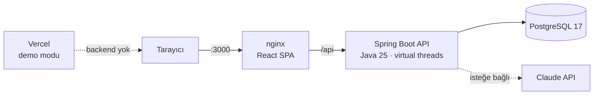
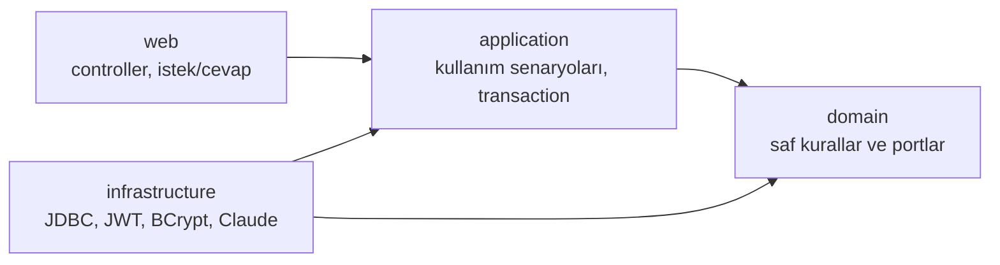
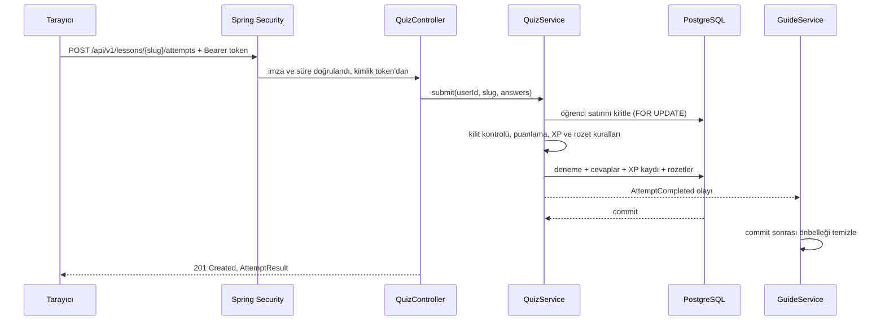

# Mimari

## Büyük resim

Sistem üç parçadan oluşuyor: React arayüzünü sunan bir nginx, bir Spring Boot API'si ve PostgreSQL.
nginx hem statik dosyaları sunuyor hem de `/api` isteklerini API'ye aktarıyor. Tarayıcı açısından her şey
aynı adreste olduğu için Docker kurulumunda CORS'a hiç gerek kalmıyor. Claude yalnızca Gece Rehberi için ve
yalnızca bir API anahtarı tanımlıysa devreye giriyor.

Vercel'deki canlı demo ayrı bir dağıtım: aynı arayüz, backend olmadan tarayıcıda çalışan bir veri
katmanıyla yayında. Neden böyle yaptığımı [Yayın stratejisi](09-yayin-stratejisi.md)'nde anlattım.

## Neden modüler monolit?

Bir quiz denemesi tek seferde dört tabloya kadar yazıyor: deneme, cevaplar, XP kaydı ve rozetler. Bu
yazmaların ya hepsinin olması ya hiçbirinin olmaması gerekiyor. Tek bir veritabanı transaction'ı bunu bedavaya veriyor.
Aynı işi mikroservislerle yapsaydım dağıtık transaction ya da saga kurmam gerekirdi. Tek kişilik bir ekip ve
bu ölçekteki bir ürün için bu, kazandırdığından çok daha fazlasını götürürdü.

Ama sınırları baştan çizdim. Backend sekiz iş modülüne ayrılıyor ve her modül diğerleriyle yalnızca
`application` katmanındaki servisleri üzerinden konuşuyor. Bir gün bir modülü ayrı servise çıkarmak gerekirse
sınır zaten belli.

**Bedeli:** Modül sınırlarını şu an derleyici kısmen, disiplin büyük ölçüde koruyor. Bu kuralları bir
mimari testiyle (ör. ArchUnit) otomatikleştirmek yol haritamda.

## Katmanlar

Her modülde aynı dört katman var. Bağımlılıklar hep içe, iş kurallarına doğru akıyor:

| Katman | Ne yaşar | Örnek |
|---|---|---|
| `domain` | Saf Java iş kuralları ve portlar (arayüzler). Spring'e tek bir import'u yok. | `XpPolicy`, `NightClock`, `QuizGrader`, `LessonStatusPolicy`, `UserRepository` |
| `application` | Kullanım senaryoları, transaction sınırları, okuma modelleri | `QuizService`, `AuthService`, `GuideService` |
| `infrastructure` | Portların gerçek dünyadaki karşılıkları | `JdbcQuizRepository`, `JwtTokenIssuer`, `SpringPasswordHasher`, `ClaudeGuide` |
| `web` | HTTP: controller'lar, doğrulama kuralları, cevap kayıtları | `QuizController`, `AuthController` |

Somut bir örnek: [`AuthService`](../backend/src/main/java/com/skillhub/identity/application/AuthService.java)
şifreyi hash'lemek için BCrypt'i bilmiyor; [`PasswordHasher`](../backend/src/main/java/com/skillhub/identity/application/PasswordHasher.java)
adında bir arayüzle konuşuyor. BCrypt'i yarın Argon2 ile değiştirmek istersem yalnızca `infrastructure`
içindeki tek bir sınıfa dokunurum; kayıt ve giriş akışı aynı kalır.

Altyapı sınıflarının hepsi *package-private*. Yani başka bir modül, bir JDBC deposunu doğrudan kullanmak
istese derleyici izin vermiyor; ancak o modülün servisini çağırabiliyor.

## Modüller

| Modül | Sorumluluk | Kullandığı modüller |
|---|---|---|
| `identity` | Kayıt, giriş, profil | `geo`; `/me` cevabı için `progress` ve `leaderboard` |
| `geo` | 81 il, Türkçe alfabetik sıralama | yok |
| `catalog` | Takımyıldızlar, dersler, ön koşul grafiği, öğrencinin gökyüzü | yok |
| `quiz` | Quiz, sunucuda puanlama, deneme geçmişi | `catalog`, `progress` |
| `progress` | XP defteri, Gece Saati, seriler, rozetler | `catalog` |
| `leaderboard` | Kişi ve şehir sıralamaları | `progress` |
| `guide` | Gece Rehberi: Claude ve kural tabanlı yedek motor | `catalog`, `progress`, `identity`, `quiz` |
| `demo` | Boş veritabanına gerçekçi demo verisi | `catalog`, `identity`, `quiz` |
| `shared` | Güvenlik, hata sözleşmesi, saat, ortak web ayarları | yok |

Bağımlılık grafiğinde döngü yok. Modüller arası tek "ters yönlü" ihtiyaç, bir quiz bittiğinde Gece
Rehberi'nin önbelleğini temizlemekti. Bunu bir **olayla** çözdüm: `QuizService` bir `AttemptCompleted` olayı
yayınlıyor, `GuideService` dinliyor. Quiz modülü rehberin varlığından haberdar değil.

## Okuma ve yazma tarafı

- **Yazma tarafı** küçük ve katı: deneme, XP kaydı ve rozet tek transaction'da yazılıyor.
- **Okuma tarafı** veriyi ekranın istediği biçimde, hazır döndürüyor. Sıralamalar için ayrı bir okuma portu
  var ([`LeaderboardQueries`](../backend/src/main/java/com/skillhub/leaderboard/application/LeaderboardQueries.java));
  sonuçlar doğrudan SQL'den, window fonksiyonlarıyla geliyor.
- **Katalog** (takımyıldızlar, dersler, ön koşullar) yalnızca migration'larla değiştiği için uygulama
  açıkken bellekte tek bir değişmez kopya olarak tutuluyor
  ([`CatalogService`](../backend/src/main/java/com/skillhub/catalog/application/CatalogService.java)).
  Her istekte değişen tek şey öğrencinin skorları; katalogla birleşip `LearnerCatalog` oluyor.

## Bir isteğin yolculuğu: quiz gönderimi

Bu akıştaki kuralların ayrıntısı [Oyun kuralları](05-oyun-kurallari.md)'nda, kilitleme ve transaction
kararlarının gerekçesi [Çözdüğüm problemler](11-cozdugum-problemler.md)'de.

## Hatalar tek yerden çıkıyor

İş kuralları HTTP bilmiyor. Bir kural ihlal edildiğinde `domain` ya da `application` katmanı
[`DomainException`](../backend/src/main/java/com/skillhub/shared/error/DomainException.java) alt türlerinden
birini fırlatıyor: `NotFound`, `Conflict`, `Forbidden`, `Invalid`, `Unauthorized`, `RateLimited`. Sınıf
`sealed` olduğu için web katmanındaki [`ApiExceptionHandler`](../backend/src/main/java/com/skillhub/shared/web/ApiExceptionHandler.java)
bunları eksiksiz bir `switch` ile HTTP durum kodlarına çeviriyor. Yeni bir hata türü eklenip eşlenmeyi
unutulursa kod derlenmiyor.

Her hata RFC 9457 Problem Details biçiminde dönüyor. Bir hata belirli bir form alanına aitse (ör. "bu e-posta
zaten kayıtlı") alan adıyla birlikte geliyor ve arayüz mesajı doğrudan o alanın altında gösteriyor.

## Zaman da bir bağımlılık

İş kuralları hiçbir yerde `Instant.now()` çağırmıyor; saat, Spring'e kayıtlı bir `Clock` nesnesi olarak
enjekte ediliyor. Bunun iki faydası var: kurallar test edilebilir oluyor ve demo verisi geçmişi
"yeniden oynatabiliyor". `QuizService.submitAt(..., at)` metodu denemenin zamanını dışarıdan alıyor;
demo öğrencilerinin dört haftalık geçmişi bu sayede gerçek kurallardan geçerek üretiliyor.

"Bugün" ve "gece yarısı" gibi kavramlar [`AppTime`](../backend/src/main/java/com/skillhub/shared/time/AppTime.java)
içinde tek bir yerde, Europe/Istanbul saatine göre hesaplanıyor.

## Neden JPA değil, JdbcClient?

- Sorgularımın önemli bir kısmı raporlama: window fonksiyonları, özyinelemeli CTE, gruplamalar. Bunları
  SQL olarak açıkça yazmak, bir ORM'in ne üreteceğini tahmin etmekten daha okunur.
- Domain modelim değişmez `record`'lardan oluşuyor. ORM'in istediği değişebilir entity'lere ve lazy
  loading'e ihtiyacım yok.
- Her sorgu kodda görünür; bir performans sorusunda neyin çalıştığını tartışmak kolay.

**Bedeli:** Satır eşlemelerini elle yazıyorum ve şema değiştiğinde SQL'leri ben güncelliyorum. Bu boyutta bir
projede bunu kabul edilebilir buldum.

## Çalışma zamanı

`docker compose up --build` üç servis kaldırıyor:

| Servis | İmaj | Notlar |
|---|---|---|
| `db` | `postgres:17-alpine` | `pg_isready` sağlık kontrolü; port yalnızca `127.0.0.1:5433`'e açık |
| `api` | Temurin 25 JDK ile derlenir, JRE ile çalışır | Root olmayan kullanıcı, `/actuator/health/readiness` sağlık kontrolü, veritabanı sağlıklı olunca başlar |
| `web` | Node 24 ile derlenir, `nginx:stable-alpine` ile sunulur | Tek açık port `3000`; API sağlıklı olunca başlar |

Başlangıç sırası sağlık kontrolleriyle garanti altında: veritabanı hazır olmadan API, API hazır olmadan arayüz
ayağa kalkmıyor. API, virtual thread'lerle çalışıyor: JDBC ve Claude çağrıları gibi bekleyen işler bir
platform thread'ini meşgul etmiyor, kod ise düz ve okunur bloklayan kod olarak kalıyor.

## Frontend tarafı

Arayüz de aynı ayrımı izliyor: her ekran `features/<ekran>/` altında kendi API kancalarıyla duruyor, ortak
parçalar `shared/` altında. Ayrıntısı: [Arayüz ve tasarım](08-arayuz-ve-tasarim.md).
