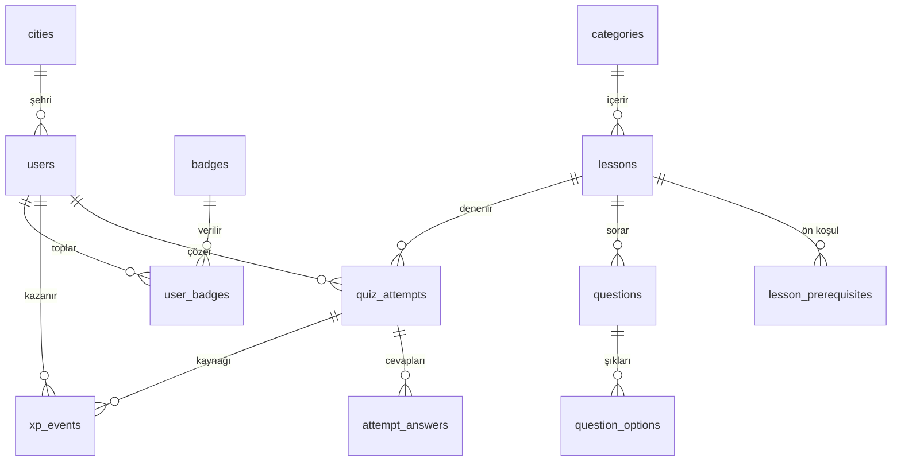
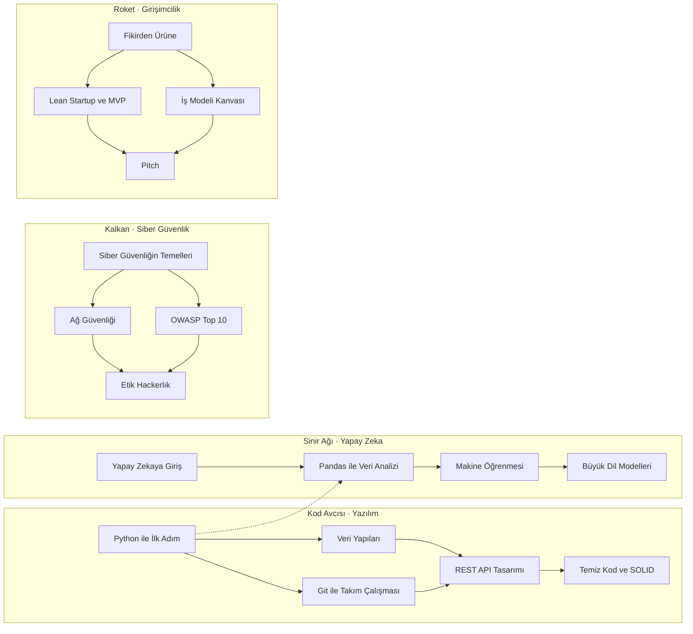

# Veritabanı

PostgreSQL 17 kullanıyorum. Şema Flyway migration'larıyla sürümleniyor ve SQL'i `JdbcClient` ile açıkça
yazıyorum. Bu dokümanda tabloları ve en çok soru gelen kararları anlatıyorum.

## Şema



| Grup | Tablolar | Not |
|---|---|---|
| Kullanıcı | `users`, `cities` | Şehir kimliği plaka kodu: 61 Trabzon, 34 İstanbul |
| İçerik | `categories`, `lessons`, `lesson_prerequisites`, `questions`, `question_options`, `badges` | Yalnızca migration'larla değişir |
| Etkinlik | `quiz_attempts`, `attempt_answers`, `xp_events`, `user_badges` | Uygulama yalnızca bunlara yazar |

Tam şema: [`V1__schema.sql`](../backend/src/main/resources/db/migration/V1__schema.sql).

## Karar 1: XP bir defter, sayaç değil

En önemli kararım bu. `users` tablosunda bir `xp` sütunu yok. Kazanılan her XP, `xp_events` tablosuna yeni
bir satır olarak ekleniyor ve bu tabloda güncelleme ya da silme yapılmıyor:

```sql
CREATE TABLE xp_events (
    id         BIGINT      GENERATED ALWAYS AS IDENTITY PRIMARY KEY,
    user_id    UUID        NOT NULL REFERENCES users (id) ON DELETE CASCADE,
    amount     INTEGER     NOT NULL CHECK (amount > 0),
    reason     VARCHAR(30) NOT NULL,
    lesson_id  SMALLINT    REFERENCES lessons (id),
    attempt_id UUID        REFERENCES quiz_attempts (id) ON DELETE CASCADE,
    created_at TIMESTAMPTZ NOT NULL
);
```

Toplam XP bir `SUM`, seviye o toplamın bir fonksiyonu, sıralama da o toplamların sıralaması.

**Neden?** Puanı bir sayaçta tutsaydım, sayaç bir kez yanlış artınca doğrusunu bulmanın yolu olmazdı.
Defterde ise:

- Kopyalanmış bir sayı olmadığı için hiçbir şey "senkron dışı" kalamaz.
- Her XP'nin kaynağı bellidir: hangi ders, hangi deneme, ne zaman. "Bu puan nereden geldi?" sorusunun
  cevabı tek bir sorgu.
- Profildeki 30 günlük XP grafiği bedavaya geliyor; günlere göre gruplamak yetiyor.
- İleride yeni bir XP kaynağı eklemek (ör. günlük bonus) yeni bir `reason` değeri demek.

**Bedeli:** Her okuma bir toplama yapıyor. `(user_id, created_at)` index'iyle bu ölçekte sorun değil.
Kullanıcı sayısı çok büyürse sıralamayı periyodik yenilenen bir materialized view'a taşırdım. Bunu
[Sorular ve sınırlar](12-sorular-ve-sinirlar.md)'da açtım.

## Karar 2: Ön koşullar bir yönlü, döngüsüz grafik (DAG)

Bir ders, ön koşulu olan dersler geçilince açılıyor. İlişki tek bir tabloda duruyor:

```sql
CREATE TABLE lesson_prerequisites (
    lesson_id       SMALLINT NOT NULL REFERENCES lessons (id) ON DELETE CASCADE,
    prerequisite_id SMALLINT NOT NULL REFERENCES lessons (id) ON DELETE CASCADE,
    PRIMARY KEY (lesson_id, prerequisite_id),
    CHECK (lesson_id <> prerequisite_id)
);
```

Bugünkü 17 dersin grafiği şöyle. Kesikli çizgi iki takımyıldızı birbirine bağlıyor: Pandas dersi Python
bilmeyi gerektiriyor.



Kilitli bir derse tıklayan öğrenciye "bunu açmak için önce şunları bitir" yolunu gösteriyorum. Bu yol,
grafikte geriye doğru yürüyen özyinelemeli bir CTE ile tek sorguda çıkıyor; en derindeki ders önce geliyor:

```sql
WITH RECURSIVE ancestors (id, depth) AS (
    SELECT prerequisite_id, 1 FROM lesson_prerequisites WHERE lesson_id = :lessonId
    UNION
    SELECT p.prerequisite_id, a.depth + 1
    FROM lesson_prerequisites p
    JOIN ancestors a ON p.lesson_id = a.id
)
SELECT id FROM ancestors GROUP BY id ORDER BY max(depth) DESC, id
```

Bir dersin kilitli mi, açık mı, tamamlanmış mı olduğunu ise bellekteki katalog üzerinden saf bir kural
hesaplıyor ([`LessonStatusPolicy`](../backend/src/main/java/com/skillhub/catalog/domain/LessonStatusPolicy.java)).

**Bedeli:** Veritabanı yalnızca bir dersin kendisine ön koşul olmasını engelliyor; daha uzun döngüleri
engellemiyor. İçerik yalnızca gözden geçirilen migration'larla değiştiği için bugün bu yeterli. Uygulama
açılışında grafiği döngüye karşı doğrulayan bir kontrol eklemek kolay bir sonraki adım.

## Karar 3: Kurallar veritabanında da korunuyor

Uygulama ilk savunma hattı, veritabanı son savunma hattı. Bir hata ya da elle yapılan bir ekleme, temel
kuralları bozamasın istedim:

| Kural | Nasıl korunuyor |
|---|---|
| Her sorunun tam olarak bir doğru şıkkı var | `CREATE UNIQUE INDEX ux_options_single_correct ON question_options (question_id) WHERE is_correct` |
| Aynı e-postayla iki hesap açılamaz (büyük/küçük harf fark etmez) | `CREATE UNIQUE INDEX ux_users_email ON users (lower(email))` |
| Aynı rozet iki kez verilemez | `user_badges` birincil anahtarı `(user_id, badge_code)`; ekleme `ON CONFLICT DO NOTHING` |
| Puan 0 ile 100 arasında, XP her zaman pozitif | `CHECK (score BETWEEN 0 AND 100)`, `CHECK (amount > 0)` |
| Zorluk ve rozet seviyesi bilinen değerlerden biri | `CHECK (difficulty IN (...))`, `CHECK (tier IN ('GOLD', 'NEON'))` |
| Şehir koordinatları Türkiye sınırları içinde | `CHECK (latitude BETWEEN 35 AND 43)`, `CHECK (longitude BETWEEN 25 AND 45)` |

Kısmi unique index'i özellikle seviyorum: "bir sorunun birden fazla doğru cevabı olamaz" kuralını tek satırla,
veri seviyesinde garanti ediyor.

## Karar 4: Kimlikler

- **`users` ve `quiz_attempts` için UUID.** Sıralı sayılar tahmin edilebilir; UUID'ler URL'de ve token'da
  güvenle dolaşabilir, kayıt sayısını da ele vermez.
- **İçerik için okunur, küçük kimlikler.** Ders `n`'nin soruları `n*10+k`, o soruların şıkları
  `(n*10+k)*10+p`. Migration dosyalarını okurken bir şıkkın hangi derse ait olduğunu kimliğinden anlamak
  mümkün.
- **Şehirler için plaka kodu.** 1-81 arası resmî kod; ek bir eşleme tablosuna gerek yok.

## Karar 5: Zaman ve "yerel gün"

Bütün zaman damgaları `TIMESTAMPTZ`; uygulama UTC yazıyor. Seri ve günlük XP gibi "gün" kavramları ise
İstanbul saatine göre hesaplanıyor:

```sql
SELECT DISTINCT (completed_at AT TIME ZONE 'Europe/Istanbul')::date FROM quiz_attempts WHERE user_id = :userId
```

Neden önemli: İstanbul'da gece 01:30'da çözülen bir quiz, UTC'de bir önceki günün 22:30'u. Gün sınırını UTC'ye
göre çizseydim gece çalışan bir öğrencinin serisi yanlış hesaplanırdı. Gece çalışmayı ödüllendiren bir
üründe bu hata en çok o öğrencileri cezalandırırdı.

## Sıralama sorgusu

Sıralama hiçbir tabloda tutulmuyor; her okumada defterden hesaplanıyor. Aynı sorgu hem genel hem şehir içi
sırayı veriyor:

```sql
WITH totals AS (
    SELECT u.id, u.display_name, u.city_id, c.name AS city_name,
           coalesce((SELECT sum(x.amount) FROM xp_events x WHERE x.user_id = u.id), 0) AS xp,
           (SELECT count(DISTINCT a.lesson_id) FROM quiz_attempts a
             WHERE a.user_id = u.id AND a.passed) AS completed
    FROM users u JOIN cities c ON c.id = u.city_id
)
SELECT id, display_name, city_id, city_name, xp, completed,
       RANK() OVER (ORDER BY xp DESC) AS global_rank,
       RANK() OVER (PARTITION BY city_id ORDER BY xp DESC) AS city_rank
FROM totals
```

`ROW_NUMBER` yerine `RANK` kullandım: aynı XP'ye sahip iki öğrenci aynı sırayı paylaşıyor. Şehir ışıkları
haritası için kullanılan sorgu `cities` tablosundan `LEFT JOIN` ile başlıyor; böylece hiç öğrencisi olmayan
iller de haritada sönük bir nokta olarak görünüyor.
Kod: [`JdbcLeaderboardQueries`](../backend/src/main/java/com/skillhub/leaderboard/infrastructure/JdbcLeaderboardQueries.java).

## Migration'lar

| Dosya | İçerik |
|---|---|
| `V1__schema.sql` | Tablolar, kısıtlar, index'ler |
| `V2__cities.sql` | 81 il; koordinatlar Wikidata'dan (CC0) |
| `V3__categories_and_badges.sql` | 4 takımyıldız ve 12 rozetin görünen bilgileri |
| `V4` – `V7` | Her takımyıldızın dersleri, soruları, şıkları ve ön koşulları |

İki kuralım var: yayınlanmış bir migration asla düzenlenmez, her değişiklik yeni bir `V<n>` dosyasıdır.
Türkçe metinlerde PostgreSQL'in `$$...$$` yazımını kullandım; "Python'da" gibi kesme işaretli kelimeleri
kaçış karakteriyle boğmak gerekmiyor.

Rozetlerin *kuralları* veritabanında değil, kodda duruyor. Tablo yalnızca oyuncunun gördüğü adı, açıklamayı ve
ipucunu tutuyor. Nedeni [Oyun kuralları](05-oyun-kurallari.md#rozetler)'nda.
