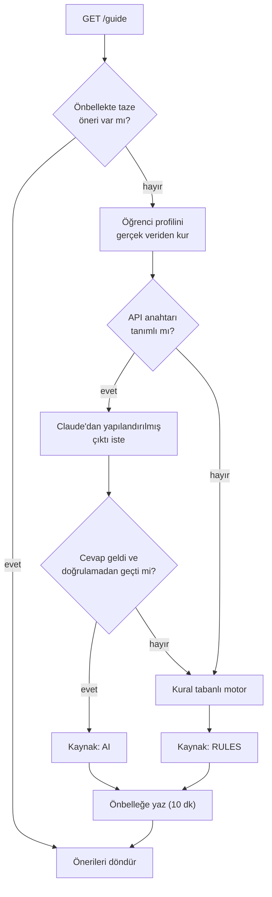

# Gece Rehberi: yapay zekâyı güvenle kullanmak

Gece Rehberi, öğrencinin durumuna bakıp ona üç kişisel öneri veriyor: sıradaki yıldız, yarım kalan bir ders,
neredeyse biten bir takımyıldız, serini koruma hatırlatması, hiç dokunmadığın bir alan ya da %100'e taşıyabileceğin
bir ders. Her öneri kartı, ilgili derse giden bir bağlantıyla geliyor.

## Hackathon'dan çıkan ders

O gece yapay zekâ asistanı iki şekilde yanılmıştı. Birincisi, anahtarı repoya commit'lendiği için Google
anahtarı kapattı ve asistan çalışmaz oldu. İkincisi, çalıştığı zamanlarda bile kendi kendisiyle çelişiyordu:
öğrenciye "Motivasyon Rozetine çok yakınsın!" diyordu ama o rozet profilde zaten kazanılmış görünüyordu.

Bu iki hatadan v2 için üç ilke çıkardım:

1. **Kural tabanlı rehber her zaman çalışır.** Anahtar yoksa, servis çökmüşse ya da model reddederse öğrenci
   yine anlamlı öneriler görür.
2. **Model yalnızca gerçek veriyi görür.** Uydurabileceği bir şey bırakmıyorum.
3. **Modelin çıktısına güvenmiyorum, doğruluyorum.** Doğrulamadan geçemeyen öneri arayüze ulaşamaz.

## Akış



Kod: [`GuideService`](../backend/src/main/java/com/skillhub/guide/application/GuideService.java).

## Modele ne gösteriyorum?

[`LearnerProfileFactory`](../backend/src/main/java/com/skillhub/guide/application/LearnerProfileFactory.java)
modele gidecek profili yalnızca veritabanındaki gerçek ilerlemeden kuruyor:

- Öğrencinin **yalnızca ilk adı**, seviyesinin adı, toplam XP'si, serisi ve bugün çalışıp çalışmadığı
- Her takımyıldızda kaç dersin bittiği
- Açık ama hiç denenmemiş dersler, denenip geçilemeyen dersler ve geçilip %100'e ulaşmayan dersler
- Tamamlanan derslerin başlıkları

Soyadı, e-posta, şehir ya da üniversite modele hiç gitmiyor. Veri dışarıdaki bir servise gidiyorsa en azını
göndermek bence varsayılan olmalı.

## İstem ve yapılandırılmış çıktı

[`ClaudeGuide`](../backend/src/main/java/com/skillhub/guide/infrastructure/ClaudeGuide.java) resmî Anthropic
Java SDK'sını kullanıyor. Sistem istemi Türkçe ve kuralları açıkça sayıyor: yalnızca profildeki verileri
kullan, ders önerirken yalnızca açık listelerdeki dersleri seç, seri hatırlatmasını yalnızca serisi olan ve
bugün henüz çalışmamış öğrenciye ver, başlık en fazla 40, gerekçe en fazla 160 karakter olsun.

Cevabı serbest metin olarak alıp ayıklamıyorum. İstediğim biçimi Java kayıtlarıyla tanımlıyorum, SDK bu
kayıtlardan bir JSON şeması üretiyor ve model bu şemaya uygun cevap veriyor:

```java
record GuideDraft(@JsonPropertyDescription("Tam olarak 3 öneri") List<Draft> recommendations) {
}

record Draft(Kind kind,
             @JsonPropertyDescription("En fazla 40 karakterlik kısa başlık") String title,
             @JsonPropertyDescription("En fazla 160 karakterlik, veriye dayalı gerekçe") String reason,
             @JsonPropertyDescription("available veya retry listesinden slug; STREAK için boş") String lessonSlug) {
}
```

`Kind` bir enum olduğu için model öneri türünü de ancak bilinen değerlerden seçebiliyor.

## Doğrulama: model bir ders uyduramaz

Şemaya uyan bir cevap, doğru bir cevap demek değil. Bu yüzden her öneriyi profille karşılaştırıyorum:

- Türü, başlığı ve gerekçesi boş olmamalı.
- Seri hatırlatması bir derse bağlanmamalı; diğer bütün öneriler, öğrencinin **gerçekten açabileceği** bir
  derse işaret etmeli.
- Aynı ders iki kez önerilmemeli, en fazla üç öneri kabul ediliyor.
- Uzun metinler kırpılıyor; dersin başlığı modelin yazdığından değil, veritabanından alınıyor.

Geçerli tek bir öneri bile kalmazsa ya da model isteği reddederse bir hata fırlatılıyor ve `GuideService`
kural tabanlı motora geçiyor. Sonuç: arayüzdeki her öneri kartı, öğrencinin açabileceği gerçek bir derse
gidiyor. Hackathon'daki "zaten kazandığın rozete yakınsın" türü bir çelişki bu yapıda oluşamıyor.

## Kural tabanlı motor

[`RuleBasedRecommendationEngine`](../backend/src/main/java/com/skillhub/guide/domain/RuleBasedRecommendationEngine.java)
saf Java, deterministik ve her zaman çalışıyor. Aday önerileri önceliklerine göre sıralayıp ilk üçünü
seçiyor:

| Öneri | Öncelik | Ne zaman |
|---|---|---|
| Sıradaki yıldızın | 100 | Açık dersler içinde en çok dersin kilidini açan; eşitse daha kolay olan |
| Yarım kalan yıldızı yak | 90 | Denenip geçilemeyen dersler içinde en düşük skorlu |
| Serini koru | 85 | Serisi var ama bugün henüz quiz çözmemiş |
| Takımyıldızını tamamla | 80 | Bitmesine en az ders kalan takımyıldız |
| Yeni bir takımyıldız keşfet | 70 | Hiç ders tamamlanmamış bir alan |
| Kusursuzluğa bir adım | 60 | Geçilmiş ama %100 olmayan en düşük skorlu ders |

Her cümle gerçek sayılardan kuruluyor: "Son denemende %50 aldın; geçmek için %70 yeterli." Aynı öneri
türlerini ve öncelikleri kullanan bir TypeScript sürümü de backend'siz demo modunda rehberi çalıştırıyor.

## Önbellek ve tazelik

- **10 dakikalık önbellek.** Öğrenci rehber sayfasını tekrar tekrar açtığında Claude her seferinde çağrılmıyor.
  Hem maliyet hem bekleme süresi düşüyor.
- **Quiz sonrası temizlik.** Bir quiz öğrencinin gökyüzünü değiştirir; eski öneriler artık doğru değildir.
  `QuizService` bir `AttemptCompleted` olayı yayınlıyor, `GuideService` bunu `@TransactionalEventListener`
  ile **commit'ten sonra** dinleyip önbelleği siliyor. Silme transaction içinde olsaydı, araya giren bir
  rehber isteği henüz commit edilmemiş eski veriyle önbelleği yeniden doldurabilir ve bayat öneri 10 dakika
  boyunca kalabilirdi.
- **Yenileme sınırı.** "Yenile" düğmesi önerileri yeniden ürettiriyor ama saatte en fazla 6 kez.
- **Dürüst arayüz.** Cevap, önerinin kaynağını (`AI` ya da `RULES`), modelin adını ve üretilme zamanını
  taşıyor. Arayüz öğrenciye önerinin Claude'dan mı kural tabanlı rehberden mi geldiğini açıkça söylüyor.

## Çalıştırma ayarları

| Ayar | Değer | Neden |
|---|---|---|
| `ANTHROPIC_API_KEY` | boş (varsayılan) | Boşsa Claude bileşeni hiç oluşturulmuyor, kural tabanlı motor tek başına çalışıyor |
| `GUIDE_MODEL` | `claude-opus-5-5` | Model tek bir ortam değişkeniyle değiştirilebiliyor |
| Zaman aşımı | 60 sn, 1 yeniden deneme | Rehber düşünürken öğrenciyi sonsuza kadar bekletmemek için |
| nginx okuma zaman aşımı | 90 sn | API'nin zaman aşımından uzun, böylece hatayı nginx değil API yönetiyor |

## Bilinen sınırlar

- Önbellek ve yenileme sayacı uygulamanın belleğinde. Tek kopya için yeterli; birden fazla API kopyasında
  Redis gibi paylaşılan bir depoya taşınmalı.
- Süresi dolan önbellek kayıtları okumada kontrol ediliyor ama bellekten silinmiyor. Gerçek trafikte
  süre sınırlı bir önbellek kütüphanesi (ör. Caffeine) kullanırdım.
