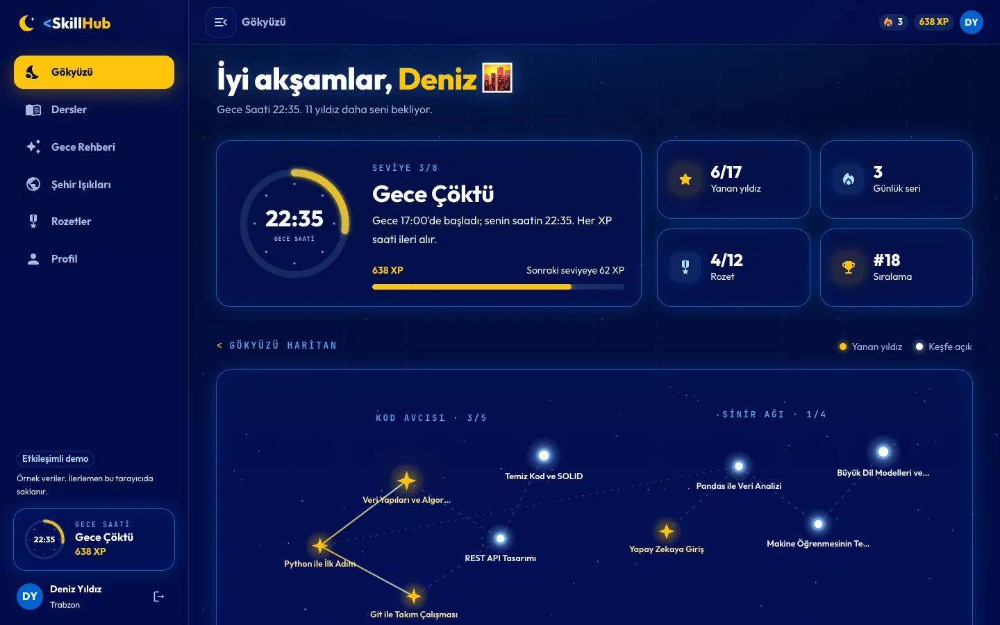
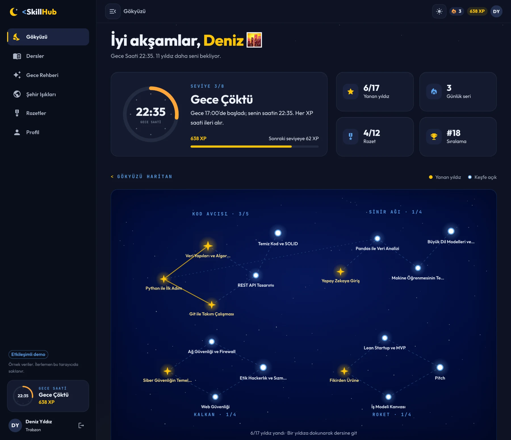
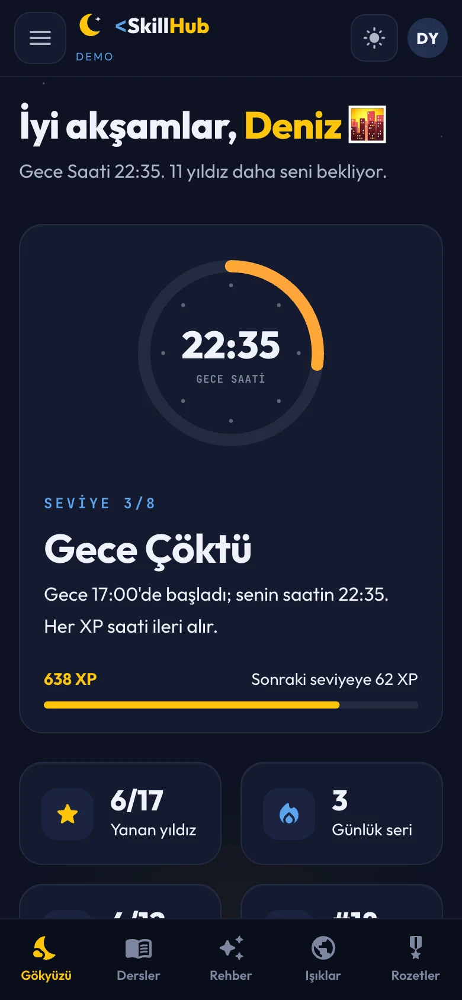
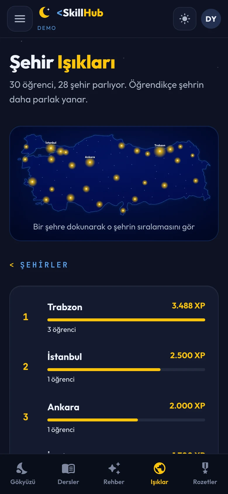

# Arayüz ve tasarım

Arayüz React 19, TypeScript (strict), Material UI 9 ve TanStack Query ile yazıldı. Bu dokümanın ilk yarısı
frontend mimarisini, ikinci yarısı "Sakin Gece" adını verdiğim tasarım dilini anlatıyor.

## Klasör yapısı

```text
frontend/src/
├── app/        Uygulama girişi, rotalar, MUI teması ve tasarım token'ları
├── features/   Her ekran kendi klasöründe: sayfa, bileşenler ve api.ts
│               auth · sky · lessons · quiz · guide · leaderboard · badges · me
├── layouts/    Uygulama kabuğu: yan menü, üst bar, mobil alt gezinme
├── pages/      Bulunamadı ve hata sayfaları
├── shared/     HTTP istemcisi, oturum, ortak tipler ve arayüz parçaları
└── demo/       Backend'siz demo modu: aynı API sözleşmesini tarayıcıda karşılar
```

Her ekranın veri kancaları kendi `api.ts` dosyasında. Başka bir ekran aynı veriye ihtiyaç duyarsa aynı kancayı
kullanıyor; böylece önbellek de paylaşılıyor. Örneğin üst bardaki XP rozeti ve profil sayfası aynı `useMe`
sorgusunu okuyor.

## Sunucu durumu: TanStack Query

Sunucudan gelen her veri TanStack Query'de yaşıyor; ayrı bir global durum kütüphanesine ihtiyaç olmadı.

- **Sorgu anahtarları tek dosyada** ([`queryKeys.ts`](../frontend/src/shared/api/queryKeys.ts)). Bir quiz
  bittiğinde değişebilecek her şeyin listesi de orada: gökyüzü, dersler, rozetler, sıralamalar, şehir
  ışıkları, rehber, XP grafiği, son denemeler ve profil özeti. Quiz gönderimi başarılı olunca bu listenin
  tamamı geçersiz sayılıyor; kullanıcı hangi ekrana dönerse dönsün güncel veriyi görüyor.
- **4xx hataları yeniden denenmiyor.** "Bu yıldız kilitli" bir cevaptır, geçici bir aksaklık değil. Ağ ya da
  sunucu hatalarında en fazla iki yeniden deneme var.
- **Tazelik süreleri veriye göre:** genel olarak 30 saniye, quiz için 0 (her açılışta taze), şehir listesi
  için sonsuz (81 il değişmiyor).

## Oturum

[`sessionStore`](../frontend/src/shared/auth/sessionStore.ts) çok küçük, framework'ten bağımsız bir depo:
`get`, `set`, `subscribe`. HTTP istemcisi React dışında olduğu hâlde onu okuyabiliyor; React tarafı ise
`useSyncExternalStore` ile abone oluyor. Redux ya da Context kurmaya gerek kalmadı.

- Oturum `localStorage`'dan okunurken doğrulanıyor: biçimi bozuk ya da süresi dolmuş bir kayıt atılıyor.
- Depolama anahtarı moda ve API adresine göre ayrı. Demo modunda üretilen bir token (`demo:` önekli) gerçek
  API'ye asla gönderilemiyor.
- API `401` dönerse oturum kapanıyor ve kullanıcı girişe yönlendiriliyor. Gitmek istediği sayfa hatırlanıyor,
  girişten sonra oraya dönüyor.
- Giriş ve çıkışta sorgu önbelleği temizleniyor; bir kullanıcının verisi bir sonrakine sızmıyor.

## Tek bir taşıma noktası: API ya da demo

Arayüzün hangi veri kaynağıyla konuşacağına tek bir yerde karar veriliyor
([`httpClient.ts`](../frontend/src/shared/api/httpClient.ts)):

```ts
if (import.meta.env.VITE_DATA_MODE !== 'api') {
  const { handleDemoRequest } = await import('@/demo/handler');
  return handleDemoRequest<T>(path, { method, body, signal });
}
```

Ekranlar hangi modda olduklarını bilmiyor; aynı istekleri atıp aynı biçimde cevap alıyorlar. Kontrol doğrudan
derleme anı sabitini okuduğu için Vite, API derlemesinde bu dalı tamamen siliyor. Yani Docker'daki gerçek
sürümde demo kodu (bütün ders ve soru kataloğu dahil) pakette hiç yer almıyor. Neden iki mod olduğunu
[Yayın stratejisi](09-yayin-stratejisi.md)'nde anlattım.

## Rotalar

- Adresler Türkçe: `/gokyuzu`, `/dersler/:slug`, `/sehir-isiklari`, `/rozetler`, `/profil`.
- Her sayfa ayrı bir parça olarak tembel yükleniyor; ilk açılışta yalnızca o sayfanın kodu iniyor.
- Quiz bir "odak modu": menüsüz, yalnızca soru ve gece arka planı.
- Bir sayfa çizilirken hata olursa beyaz ekran yerine sakin bir hata sayfası çıkıyor.

## Tasarım dili: Sakin Gece

### İlk deneme

v2'nin ilk tasarımında Code Night'ın görsellerinden ölçtüğüm doygun laciverti (`#010D3C`) her yerde
kullandım: arka plan, kartlar, kenarlar, parıltılar, yan menü. Her sayfanın arkasında bir de 0 ve 1'lerden
oluşan bir "matrix yağmuru" akıyordu. Ekran görüntüsünde etkileyiciydi ama uzun kullanımda boğuyordu. Her şey
parladığı için hiçbir şey öne çıkmıyordu; sarının ve neonun değeri kayboluyordu.

| Önce | Sonra |
|---|---|
|  |  |

### Sakin Gece kuralları

Tasarımı tek bir metafora bağladım: **dışarısı gece, içerisi sakin bir oda.**

- **Çalışma yüzeyleri** doygunluğu düşürülmüş mürekkep lacivertinde (`#0D1222`). Göz dinleniyor.
- **Code Night laciverti yalnızca "pencerelerde":** giriş ekranındaki Karadeniz gecesi, gökyüzü haritası ve
  Türkiye haritası. Gece, bu pencerelerden görünen bir manzara oldu.
- **Işık bir ödül.** Varsayılan kartlarda parıltı yok. Yalnızca kazanılmış ya da seçili öğeler ince bir altın
  veya neon kenarlık alıyor.
- **Altın bir dolgu.** Code Night sarısı (`#FDC40B`) butonlarda, ilerleme çubuklarında ve yanan yıldızlarda.
- **Ufukta şafak.** Ekranın alt kenarında zar zor fark edilen bir şafak ışığı var; öğrencinin Gece Saati
  ilerledikçe güçleniyor.

Renkler Code Night'ın resmî görsellerinden ölçüldü ve kontrastları hesaplandı. Örneğin sarı, gece laciverti
üzerinde 11,6:1 kontrast veriyor; ama beyaz üzerinde yalnızca 1,6:1. Bu yüzden açık temada sarı hiçbir zaman
yazı rengi olarak kullanılmıyor.

### Token'lar ve iki renk şeması

- Bileşenlerde sabit renk yok. Her renk [`tokens.ts`](../frontend/src/app/theme/tokens.ts)'ten geliyor.
- İki şema var: varsayılan koyu **Gece** ve açık **Şafak** ([`schemes.ts`](../frontend/src/app/theme/schemes.ts)).
  Açık şemada yazılar en az 4,5:1, ikon ve kenarlıklar en az 3:1 kontrasta göre seçildi.
- Token'lar CSS değişkeni. MUI'nin `colorSchemes` ve `cssVariables` desteğiyle şema değiştirmek, `<html>`
  etiketindeki tek bir niteliği değiştirmek demek. Bileşenler yeniden çizilmeden renkler değişiyor.
- `index.html` içindeki küçük bir betik, React yüklenmeden önce kayıtlı tercihi okuyup uyguluyor. Sayfa
  yenilendiğinde yanlış renkte bir an parlama olmuyor.
- CSS değişkenleri SVG niteliklerinde çalışmadığı için orada `style` kullanılıyor; şeffaflık için renk koduna
  ek yapmak yerine `color-mix` kullanılıyor.

### Görselleştirmeler

- **Gökyüzü haritası** bir SVG. Takımyıldızlar kategoriler, yıldızlar dersler, çizgiler ön koşullar.
  Yıldızların yerleri veritabanından geliyor (`star_x`, `star_y`). Arka plandaki yıldız tozu tohumlu bir
  rastgele sayı üreteciyle çiziliyor; gökyüzü her ziyarette aynı görünüyor. Yıldızlara klavyeyle de
  ulaşılabiliyor; telefonda harita yatay kaydırılıyor.
- **Türkiye gece haritası** Natural Earth'ün kamuya açık sınır verisinden çizildi. Eşdikdörtgen izdüşümü
  Türkiye'nin orta enlemine (39°) göre ölçekledim; böylece ülke yatayda basık ya da uzamış görünmüyor. Bir
  şehrin ışık yarıçapı XP'nin kareköküyle büyüyor, çünkü göz yarıçapı değil alanı algılıyor. Öğrencisi
  olmayan iller sönük birer nokta olarak kalıyor.
- **XP grafiği** MUI X Charts ile çizilen 30 günlük bir çizgi grafik.
- **Rozetler** dokununca dönen koleksiyon kartları.

## Erişilebilirlik

- Klavyeyle gezenler için sayfanın başında "İçeriğe geç" bağlantısı var.
- Haritalar ekran okuyucuya özet okuyor: "Şehir ışıkları haritası. En parlak şehirler: 1. ..., 2. ...".
- Quiz klavyeyle çözülebiliyor: 1-4 ya da A-D şık seçiyor, Enter ilerletiyor, oklar sorular arasında geziyor.
- Hareketi azaltmayı seçen kullanıcılar için animasyonlar kapanıyor (`prefers-reduced-motion`).

## Mobil

Hackathon sürümünde ders sayfaları 390 px'lik bir telefon ekranından taşıyordu. v2'yi önce telefon için
tasarladım: alt gezinme çubuğu, açılır kapanır menü, çentikli ekranlar için güvenli alan boşlukları ve akışkan
yerleşimler.

<p>
  
  
  
</p>

## Performans

- Rota bazında kod bölme: her sayfa kendi parçası.
- Yazı tipleri (`Outfit`, `JetBrains Mono`) pakete gömülü; harici bir font isteği yok.
- Giriş görseli iki boyutta (900 ve 1536 piksel genişlik, WebP); ekran boyutuna göre doğru olanı iniyor.
- nginx, adında içerik özeti olan derleme dosyalarını kalıcı önbelleğe alıyor; `index.html` ise her seferinde
  yeniden doğrulanıyor. Yeni bir sürüm yayınlandığında kullanıcı eski koda takılmıyor.
